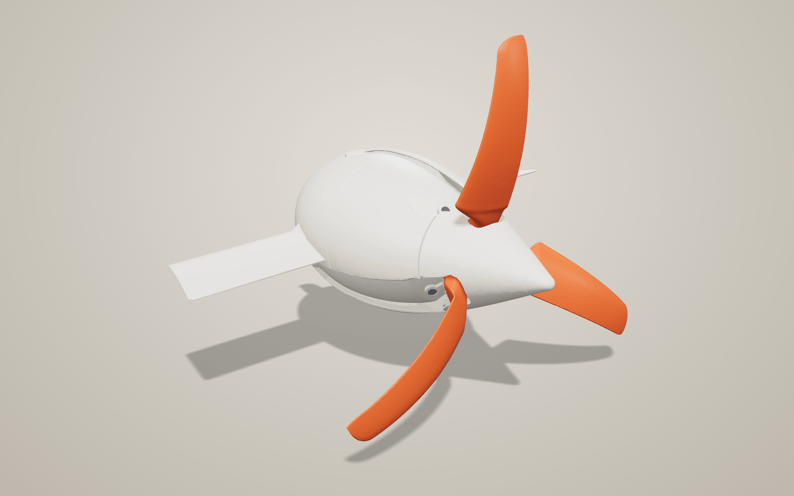
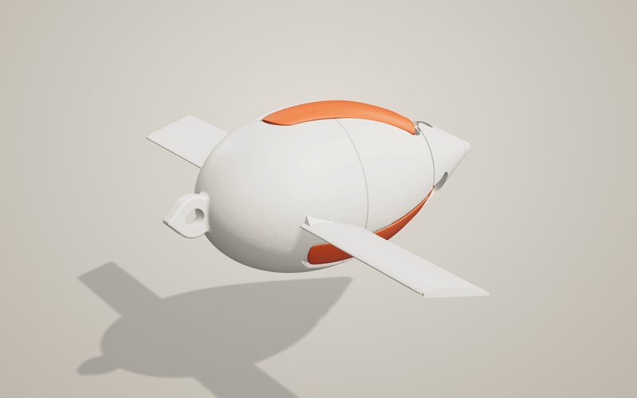
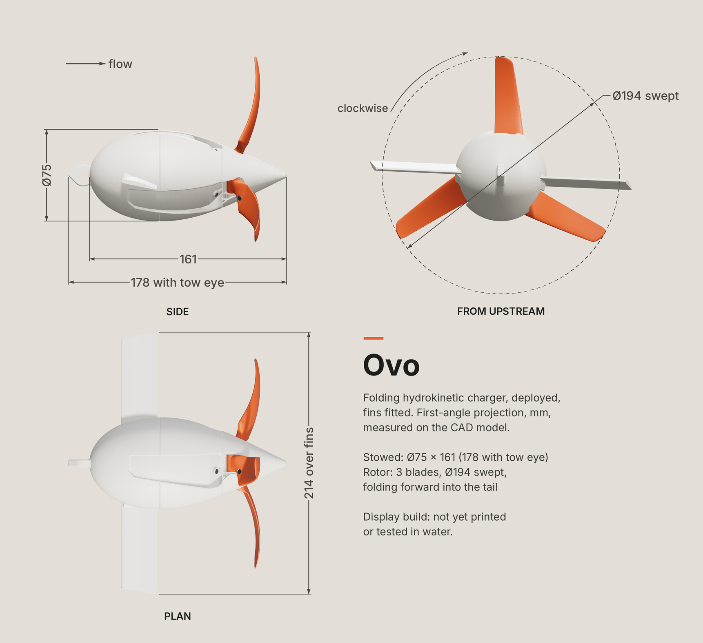
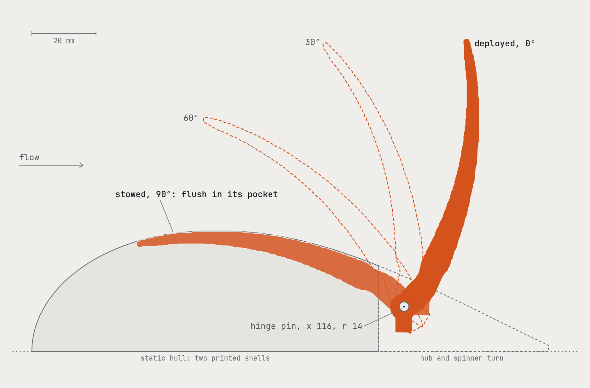
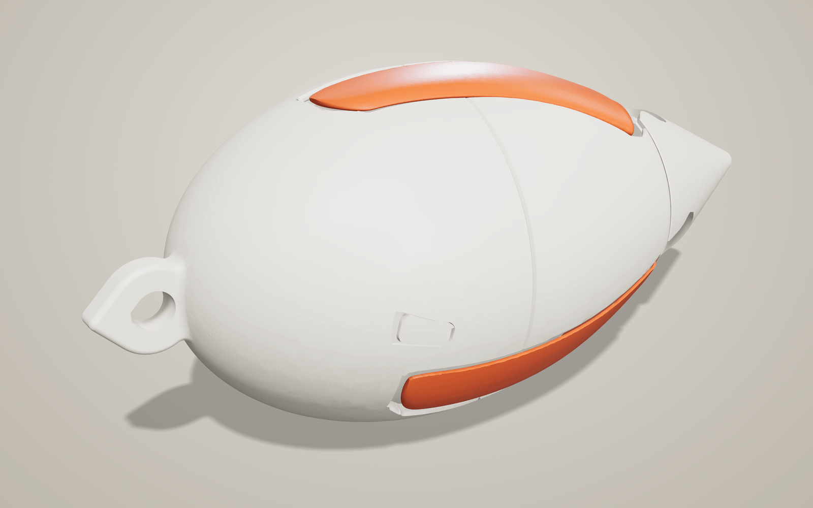
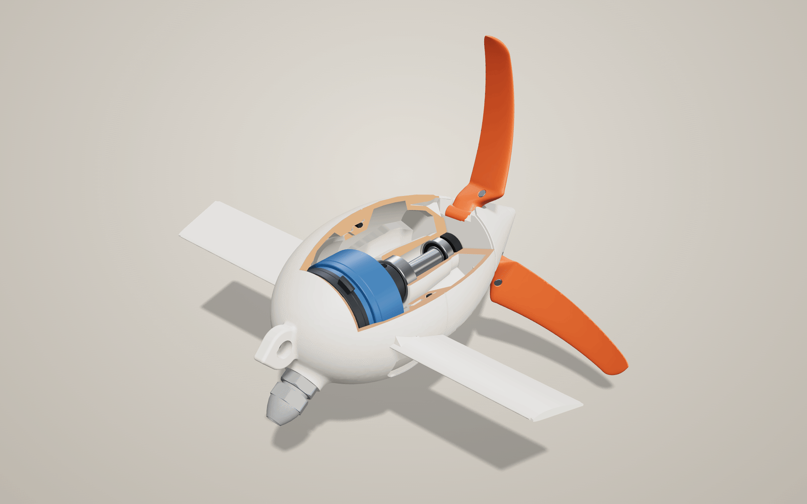
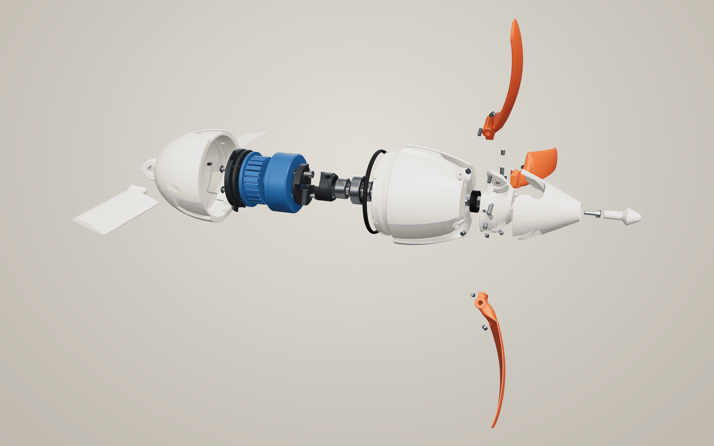
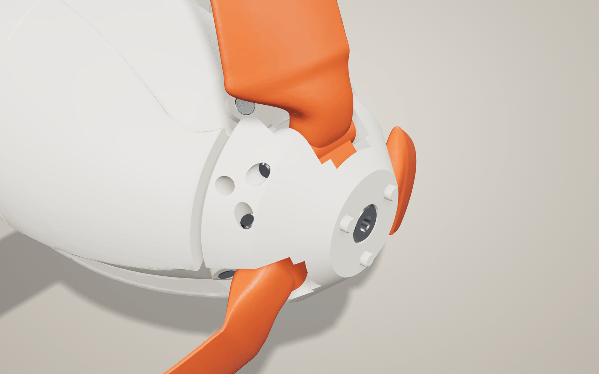

<p align="center">
  <picture>
    <source media="(prefers-color-scheme: dark)" srcset="docs/media/hero_dark.png">
    
  </picture>
</p>

# Ovo

**A folding hydrokinetic charger, designed end to end as parametric code-CAD.**

Ovo is a small water turbine for charging a phone or a power bank from a river current, or while
towed behind a boat. Packed, it is a 75 mm x 161 mm egg. In the water, three blades fold out of
flush pockets in its tail and become a 194 mm rotor downstream of the hull. Every part is generated
with [build123d](https://github.com/gumyr/build123d) from one Python parameter file and the
design-study tables beside it; the blades come from a blade element momentum (BEM) study that
prices each printability constraint in lost power; and one command rebuilds the 72-part assembly,
its interference and clearance checks, the STEP and STL files and the renders. Everything prints
on a 256 mm Bambu Lab printer.

> **Status: v1 display build.** The mechanics are real (a stainless shaft on two ball bearings,
> blades that fold on steel pins and are held by magnet detents, a bayonet joint with an O-ring
> gland), but there are no electronics yet, and nothing has been printed or tested in water.
> **Every performance figure in this repository is a model estimate**, not a measurement.

<p align="center">
  
</p>

## Key numbers

| | value | source |
|---|---|---|
| Packed size | egg D75 x 161 mm (178 mm with the tow eye), fins off | `ovo/params.py`, `out/web/ovo.glb` |
| Rotor | 3 folding blades, D194 mm, downstream of the hull | `ovo/params.py` |
| Blade | NACA 44xx, t/c 18 to 12 %, chord 25.1 to 14.0 mm, twist 17.2 to 5.2 deg, 12 deg aft pre-cone | `data/blade_design.json` |
| Design point | 1.5 m/s river current, design tip speed ratio (TSR) 4 | `ovo/params.py` |
| Power coefficient (estimate) | Cp 0.367 at TSR 3.82, 1.5 m/s (Betz limit 0.593) | `data/blade_design.json` |
| Shaft power at the Cp peak (estimate) | 5.1 / 18.3 / 44.4 / 87.9 W at 1.0 / 1.5 / 2.0 / 2.5 m/s | `data/blade_design.json` |
| At 1.5 m/s, at the Cp peak (estimate) | 564 rpm, 0.31 N m, 23.8 N thrust | `data/blade_design.json` |
| At 1.5 m/s with the GL40 and a diode bridge (estimate) | the generator runs the rotor faster: TSR 6.05, 894 rpm, 0.155 N m, 14.6 W at the shaft | `data/hardware.json` |
| Cost of printability (estimate) | Cp 0.3757 (unconstrained BEM optimum) to 0.3666 (printable blade): -2.4 % | `data/blade_design.json` |
| v2 electrical output (estimate) | 7.7 W DC through a diode bridge, 8.9 W with active rectification, at 1.5 m/s (CubeMars GL40 generator) | `data/hardware.json` |
| Parts | 72 in the bill of parts (71 modelled solids plus the brass seal-fitting sleeve, a BOM-only fitting tool): 27 printed (from 25 STL files; the 3 blades share `blade.stl`) and 45 hardware parts (bought items and their sub-parts); the display build prints 18 of them, plus 3 blade cradles | `docs/notes/cad.md`, `out/cad/checks/assembly.json` |
| Filament (estimate) | 235 g for the display build (PLA 204 g, PETG 31 g) | `out/cad/checks/assembly.json` |
| Code | about 21,000 lines of Python; full rebuild from scratch about 34 min on a laptop | `ovo/`, `docs/notes/cad.md` |

<p align="center">
  
</p>

## How it works

### The fold

The rotor sits **downstream** of the hull and each blade hinges on a 3 mm steel pin that runs
tangentially through the hub (hinge at x 116 mm, r 14 mm). To stow, a blade folds **forward** by
90 deg over the static tail and lies in a shallow pocket in the hull. This is the key decision of
the design: a folded blade points upstream, so the current is meant to drag its tip aft and open it,
and rotor thrust then holds it on its deployed stop. With the rotor in front of the hull, the flow would
hold the blades shut. Whether the current alone overcomes the stowed magnet detent is one of the
things the water test has to show ([layout.md](docs/notes/layout.md), open issue 9).

Folding about a tangential axis maps "aft" to "outward". So the blade's pitch axis is solved to
copy the hull curve: deployed, it gives the rotor a mild aft cone (passive yaw stability, less root
bending); stowed, the same blade hugs the convex tail, 0.34 mm clear of its pocket. N52 magnet
pairs hold each blade in both positions (about 2.3 N each, modelled), and the pockets index the
rotor so it cannot spin in a bag. The two roll fins come off for packing and flush blanking strips
fill their rails, so the packed product is a clean 75 mm egg.

<p align="center">
  <picture>
    <source media="(prefers-color-scheme: dark)" srcset="docs/media/fold_kinematics_dark.png">
    
  </picture>
</p>

*One blade in its own plane at fold 0, 30, 60 and 90 deg, traced from the CAD model as built.*

### The blade

The blade comes out of a BEM model (Prandtl tip and hub loss, Buhl high-induction correction,
24 elements) with section polars from [NeuralFoil](https://github.com/peterdsharpe/NeuralFoil), an
XFOIL-trained network that covers the low Reynolds numbers of a small rotor (about 36,000 to
146,000 here). The study starts from the unconstrained BEM optimum and adds the real constraints
one at a time, re-optimising after each: a 0.6 mm blunt trailing edge (printable), straight chord
and twist laws, chord between 14 and 28 mm (three blades must lie side by side around the tail),
a root-twist cap for the fold and the 12 deg cone. Together they cost 2.4 % of Cp.

<p align="center">
  
</p>

The same model couples the rotor to the candidate generators. A gimbal motor has enough winding
resistance that net electrical power peaks well above the rotor's Cp peak (at 1.5 m/s with the GL40:
TSR 5.75 at the generator terminals, 6.05 through a diode bridge). From 2.2 m/s that point would
cavitate the blade tips, so the study also writes a cavitation-capped load line for the future
controller. It leaves one conflict open: from about 2.1 m/s that load line needs more torque than the
GL40's continuous rating (3.4 times its rated copper loss at 2.5 m/s, estimate), so towing above
about 2.1 m/s is not settled yet (see the v2 roadmap). The full derivation, checks and caveats
are in [docs/notes/blade-design.md](docs/notes/blade-design.md).

### Drivetrain and joint (v2-ready)

* An 8 mm hardened stainless shaft runs on a 608-2RS (front, locating) and a 688-2RS (rear,
  floating) in a printed bearing tube; a set-screw collar takes the rotor thrust.
* Aft of the rear bearing there is a pocket for a TC 8x16x5 lip seal, so v2 can seal the shaft.
* A printed claw coupling connects the shaft to the generator bay (D50.5 x 24 mm), sized for a
  CubeMars GL40 KV70 gimbal motor picked from a 12-candidate trade study. The display build
  carries a printed replica with the same envelope and hole patterns.
* The egg splits at its equator: an AS568-141 O-ring in a radial gland, a three-lug bayonet with a
  35 deg twist, and three printed flexure tines that click into the locked position.
* Two Clark Y fins (30 x 70 mm, opposite 12.5 deg incidence) slide into recessed dovetail rails and
  make a roll couple against the generator's reaction torque (nominally 1.14 x the GL40 load-line
  torque at 1.5 m/s, estimate).

| | |
|---|---|
|  |  |
| **Packed**: blades stowed in their pockets, fins off, blanking strips in | **Cutaway**: shaft, bearings, claw coupling and the generator replica (v2 front shell with the cable gland) |
|  |  |
| **Exploded**, in assembly order | **Hub** (spinner removed): blade roots on their hinge pins |

More renders and close-ups (fin rail, nose, blade) are in [docs/media](docs/media). Part by
part detail: [docs/notes/cad.md](docs/notes/cad.md); bearings, seal, O-ring gland and the
generator trade study: [docs/notes/hardware-and-prior-art.md](docs/notes/hardware-and-prior-art.md).

## Verification

The assembly is checked by `ovo/cad/assembly.py` on every build (`out/cad/checks/assembly.json`):
the part audit on the B-rep solids, and the interference, clearance and spin checks on fine meshes of
them (0.02 mm chord, 0.03 mm on the shells):

| check | result |
|---|---|
| Part audit | 71 of 71 parts are valid solids |
| Interference matrix, 7 states (stowed, deployed, fold 30, fold 60, cutaway, packed, v2) | 0 defects (intended overlaps such as press fits are declared and excluded) |
| Key clearances, measured against their design values | 25 of 25 pass (for example: stowed blade to its detent boss 0.171 mm, stowed blade to pocket floor 0.337 mm, hub running gap 0.600 mm, blade knuckle to hinge pin 0.149 mm) |
| Rotor spin sweep, 10 deg steps | 0 rubbing pairs |
| STL audit | 25 files (the 3 blades share `blade.stl`): watertight, consistent winding, no folded slivers, all fit the 256 mm bed |
| Web viewer vs CAD | blade fold pivots agree within 0.0105 mm |
| BEM solver | reproduces the Glauert optimum rotor (Cp 0.51847 against 0.51847 from theory) |

The CI [build workflow](.github/workflows/build.yml) rebuilds every CAD output from scratch (the
media, report and site are made locally) and fails if any of the CAD checks above fails (parts,
interference, clearances, spin, the full STL audit, the viewer check) or any module check is false.

What is **not** verified yet: no part has been printed, the fits rely on tolerance coupons that
are still to be printed, magnet forces and the bayonet click are modelled, the generator numbers
rest on datasheets (its iron loss is assumed), and there is no water test. See the v2 roadmap.

## Repository map

```
ovo/params.py            every dimension and design value (single source of truth)
ovo/profile.py           hull profile r(x): Myring body of revolution, L/D 2.15 as built
ovo/bem.py               blade design study      -> data/blade_design.json, docs/figures/bem_*.png
ovo/layout.py            rotor layout: hinge, curved pitch axis, pockets  -> data/layout_rotor.json
ovo/layout_internal.py   joint, generator bay, fins, mass and the merge   -> data/layout*.json
ovo/cad/                 build123d parts: shells, blade, rotor, drivetrain, fins, coupon;
                         assembly.py integrates them, runs the checks and exports
ovo/export_web.py        GLB + manifest for the viewer
scripts/build.py         one-command rebuild of every CAD output
scripts/render.py        headless renders through the viewer
scripts/media.py         README and site media (stills, fold GIF and MP4)
scripts/report.py        technical report (typst) -> docs/report/ovo-report.pdf
viewer/index.html        three.js viewer: fold, spin, explode, cutaway, packed (URL parameters)
site/                    project web page with the interactive 3D model (scripts/site.py refreshes its assets)
data/                    design-study outputs (JSON) read by the CAD
docs/                    design brief, engineering notes, figures, media, report (index: docs/README.md)
out/                     generated, git-ignored: STEP, STL, GLB, renders, checks (CI publishes them)
Makefile                 setup, build, media, report, site, all
.github/workflows/       build.yml (CI rebuild, artifacts, release zip), pages.yml (publish site/)
```

## Quick start

Requirements: [uv](https://docs.astral.sh/uv/) (it installs Python 3.12 itself), Node.js and GNU
make. Developed on Linux (WSL2); macOS also needs `flock` (`brew install flock`).

```bash
git clone https://github.com/lucaramirezo/ovo.git
cd ovo
make setup                                             # uv sync: build123d, NeuralFoil, trimesh, typst
npm install -g agent-browser && agent-browser install  # headless Chrome for the viewer check and renders
make build                                             # every CAD output, about 34 min from scratch
```

`make build` runs `scripts/build.py`: the six part modules, then the assembly checks and exports,
then the renders, and prints a summary table (`make summary` reprints it). It writes:

| output | what |
|---|---|
| `out/cad/stl/*.stl` | print files, already in print orientation |
| `out/cad/step/*.step` | every modelled part (the 3 blades share `blade.step`; the detent magnets that the assembly adds, the cut O-ring and the blade cradle have no file of their own), plus `ovo_assembly_stowed.step` and `ovo_assembly_deployed.step` |
| `out/web/ovo.glb`, `manifest.json` | the scene for `viewer/index.html` (`make viewer`) |
| `out/renders/*.png` | hero, stowed, packed kit, cutaway, exploded, side, front |
| `out/cad/checks/*.json` | every module's checks and the assembly report |

`make media`, `make report` and `make site` regenerate the README media, the PDF report and the
web page, in that order (`make site` ends with a check that all three come from the same CAD build);
`make all` runs everything, and `make links` checks that the repository, release and Pages links answer
before they are shared. The design studies are separate and slower; their outputs in
`data/` are committed: `.venv/bin/python -m ovo.bem` (about 8 min), then `-m ovo.layout` and
`-m ovo.layout_internal`. The hardware and generator study is a sourced desk study:
`data/hardware.json` and `data/bom.json` are its record, every value with its source; its working
scripts are not published. No time to build? The [build workflow](.github/workflows/build.yml)
publishes the STL, STEP and GLB files as artifacts, and every tagged release carries a zip of the
print files and the two STEP assemblies.

## Print it

Printer: Bambu Lab A1, P1S or X1 (256 mm cube), 0.4 mm nozzle, one material per plate. Plate 2
mixes two colours (orange blades, ivory rest): without an AMS, add a filament change or print the
blades as a separate job.
The STLs are already oriented and need no slicer supports: each blade prints on its own
sacrificial cradle (`blade_cradle.stl`), loaded with the blade as one object.

| plate | parts | material |
|---|---|---|
| 0 | tolerance coupons: print and test these first | PLA (and a PETG copy) |
| 1 | front and aft shells, fin blanking strips | ivory PLA |
| 2 | hub, spinner, spinner cap, 3 blades on their cradles | PLA (orange blades, ivory rest) |
| 3 | fins, motor carrier, adapter spacer, claw coupling | PETG |
| 4 | cutaway shells (optional display variant) | PLA |
| 5 | generator replica | blue PLA |
| 6 | v2 front shell with the cable gland seat (v2 wet build only) | PETG |

Bought parts for the display build: one 608-2RS and one 688-2RS stainless bearing, a machined
8 x 75.5 mm hardened shaft, a Ruland MSC-8-SS collar and shim, 3 + 6 ISO 8734 pins (3 x 22 hinge
pins, 3 x 4 fillers), 18 N52 magnets (6 discs 4 x 2, 6 blocks 6 x 2 x 2, 6 blocks 4 x 2 x 2), a few
M3 screws and two heat-set inserts. Cost (estimate, two bases): the hardware study's list
([data/bom.json](data/bom.json), drawn up before the CAD) comes to EUR 35.48 cash outlay for its
priced lines in pack sizes and minimum orders; the priced lines of the as-built list come to
EUR 11.88 pro rata (technical report, section 10). The shaft, collar, pins, block magnets,
screws and seals are not priced yet. The as-built part list with quantities is section 3 of
[docs/notes/cad.md](docs/notes/cad.md).

Step by step, per part settings, plate layouts and post-processing:
[docs/notes/print-plan.md](docs/notes/print-plan.md).

## v2 roadmap

1. **Print and fit**: print the tolerance coupons, set the press fits and seats, print the display
   build, check the fold, the detent feel and the bayonet click by hand.
2. **Generator**: fit a CubeMars GL40 KV70 and bench-test it (resistance, KV, inductance, no-load
   loss) to replace the assumed iron drag in the estimates.
3. **Electronics**: three-phase rectifier and buck-boost to 5 V USB, rated for at least 60 V input
   (the free-wheeling rotor reaches an estimated 35.2 V peak at 2.5 m/s, though the rotor must stay
   loaded: free-wheeling, it would cavitate and let the fins roll the hull), maximum-power tracking
   with the cavitation cap, and a current limit at the generator's rating; cable out through the v2
   front shell's M12 gland. Open: the current limit and the cavitation cap conflict above about
   2.1 m/s (options: a bigger generator, a short-time overload, a brake, or towing at most about
   2.1 m/s).
4. **Sealing**: PETG shells, the lip seal and the equator O-ring; leak test before any water.
5. **Water test**: Cp against TSR in a current or under tow, roll angle with the fins, blade
   opening from the stowed detent; compare with the BEM estimates.
6. **Design follow-ups** already identified: re-run the blade loads on the as-built hinge, a tow
   bridle or swivel for roll, crush ribs to locate the fins, buoyancy trim.

## Documentation

* [docs/README.md](docs/README.md): index of the design brief, notes, figures, media and report
* [docs/design-brief.md](docs/design-brief.md): requirements and the decisions behind the concept
* [docs/report/ovo-report.pdf](docs/report/ovo-report.pdf): the technical report
* [site/](site/): the project page with the interactive 3D model, published to GitHub Pages by
  the [pages workflow](.github/workflows/pages.yml)

## Credits and licences

Designed by Luca Ramírez Olivo.

Built on [build123d](https://github.com/gumyr/build123d) and OpenCascade (OCP),
[NeuralFoil](https://github.com/peterdsharpe/NeuralFoil) and AeroSandbox,
[trimesh](https://github.com/mikedh/trimesh), [manifold3d](https://github.com/elalish/manifold),
NumPy, SciPy and Matplotlib, [three.js](https://threejs.org) and [Typst](https://typst.app).
Method references: Myring (1976) for the hull profile; Buhl (NREL/TP-500-36834, 2005) and Ning
(Wind Energy 17, 2014) for the BEM high-induction correction and solver, checked against
Glauert's optimum rotor; the report lists the full set. Datasheets and product sources are cited
with every value in [data/hardware.json](data/hardware.json).

* Code (`ovo/`, `scripts/`, `viewer/`, the site code, the Makefile and the CI workflows): MIT, see
  [LICENSE](LICENSE).
* CAD models and their exports (STEP, STL, GLB), renders, figures, media, the report and the
  documentation: CC BY 4.0, see [LICENSE-CC-BY-4.0.txt](LICENSE-CC-BY-4.0.txt).
