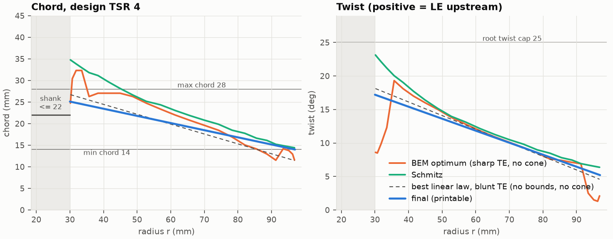
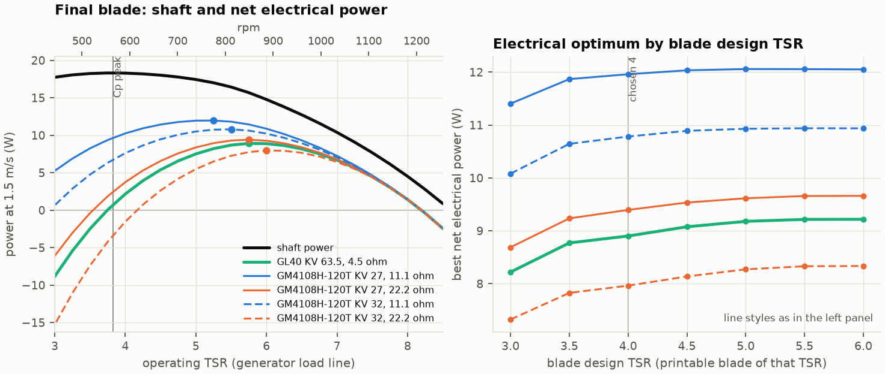
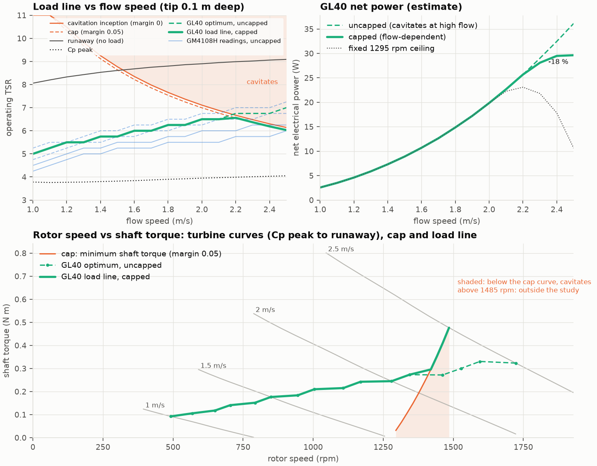
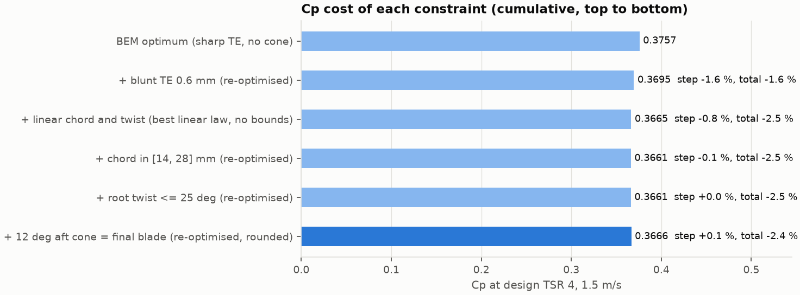
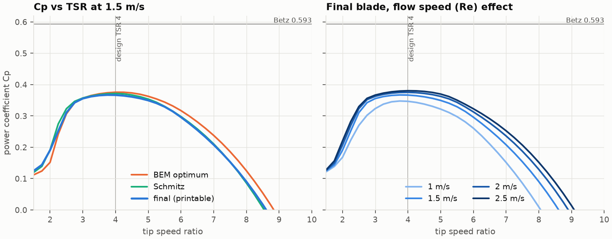
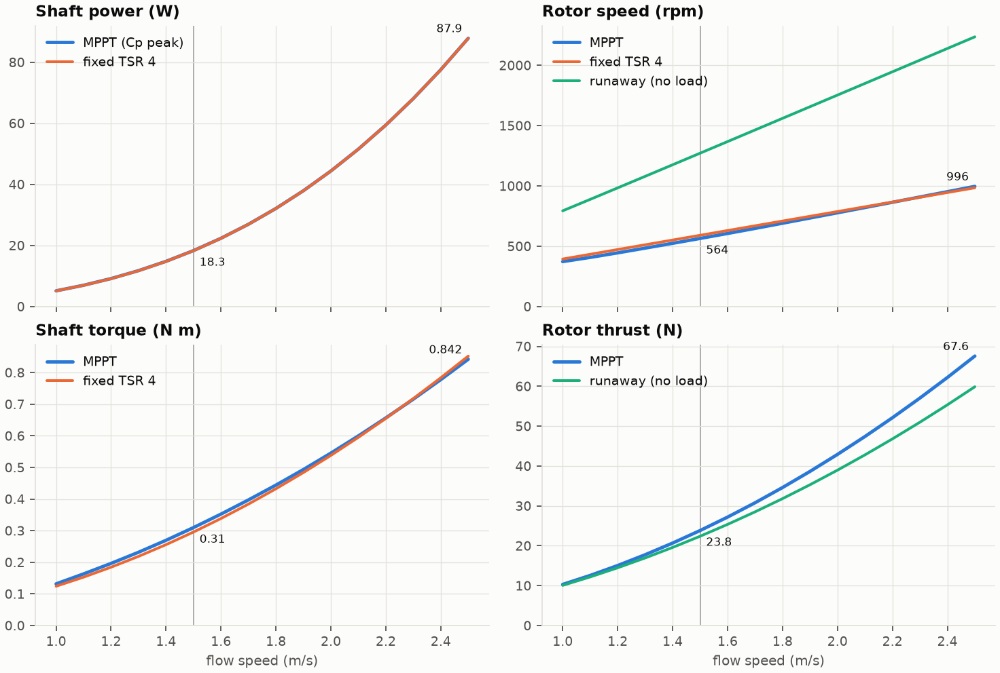

# Blade design: constraint-aware BEM

Status: v1 design, 2026-10-03. Source: `hydroegg/bem.py`. Outputs: `data/blade_design.json`
(schema `hydroegg.blade_design/1`) and `docs/figures/bem_*.png`.

Every table between `<!-- bem:NAME -->` markers is rendered from `data/blade_design.json` by
`python -m hydroegg.bem --notes` (a full run refreshes them too). Do not edit those tables by hand;
numbers quoted in the prose are taken from them.

## Summary

<!-- bem:headline -->
| result | value |
|---|---|
| blade design TSR / Cp peak at 1.5 m/s | 4 / Cp 0.367 at TSR 3.82 |
| at the Cp peak, 1.5 m/s: shaft power, rpm, torque | 18.3 W, 564 rpm, 0.310 N m |
| at the Cp peak, 1.5 m/s: thrust, flap moment per blade at the hinge | 23.8 N, 0.418 N m |
| Cp cost of all constraints at the design TSR | 0.3757 (BEM optimum) to 0.3666 (-2.4 %) |
| shaft power at the Cp peak, 1 / 2.5 m/s | 5.1 W / 87.9 W |
| runaway (no load) at 2.5 m/s: rpm, thrust | 2236 rpm, 59.9 N |
| electrical optimum, recommended generator CubeMars GL40 KV70 (estimate) | TSR 5.75, 849 rpm, 0.176 N m, 1.01 A, net 8.9 W at the terminals |
| electrical optimum, all 5 generator readings (estimate) | TSR 5.25 to 6.00, 775 to 886 rpm, 0.159 to 0.209 N m |
| recommended generator load line, 1 to 2.5 m/s (estimate, cavitation-capped) | TSR 5.00 to 6.56, 492 to 1485 rpm; cap active from 2.2 m/s, net-power cost at 2.5 m/s 18.0 % |
<!-- /bem:headline -->

The printable blade is a straight-tapered, linearly twisted NACA 44xx blade (t/c 18 % at the root
to 12 % at the tip) with a 0.6 mm blunt trailing edge, a 12 deg aft pre-cone and a stubby lug shank
from the hinge to the aerodynamic root. It is designed for TSR 4 at 1.5 m/s. Together, all printability
and folding constraints cost 2.4 % of Cp against the unconstrained BEM optimum at the design TSR: the blunt
trailing edge 1.6 %, the straight chord and twist laws 0.8 % (best linear law), the chord floor and cap
0.1 %, the root-twist cap nothing, and the cone gains 0.1 % (section 5).

The blade peaks at TSR 3.82, but the gimbal-class generators in the hardware study have enough winding
resistance that net electrical power peaks well above the Cp peak: at TSR 5.25 to 6.00 (775 to 886 rpm) at
1.5 m/s, and higher as the flow rises (GL40: TSR 5.00 at 1.0 m/s to 7.00 at 2.5 m/s). From 2.2 m/s that
optimum would cavitate the tip, so the generator controller should track it under a cavitation cap, which
costs 18.0 % of net power at 2.5 m/s and can be applied as a minimum shaft torque above 1295 rpm
(section 4). Designing the blade itself for a higher TSR would gain at most a few percent electrically at
1.5 m/s. The hinge loads are provisional: the layout study has moved the hinge, which raises the flap
moment by about 6 % (section 7).

## 1. Geometry and conventions

<!-- bem:rotor -->
| quantity | value |
|---|--:|
| blades | 3 |
| tip radius (perpendicular to axis) | 97 mm (swept D 194 mm) |
| aerodynamic root radius | 30 mm |
| hinge radius / hinge x | 18.5 mm / 124 mm |
| aft pre-cone (straight pitch axis) | 12 deg |
| design flow / design TSR | 1.5 m/s / 4 |
| TSR of the Cp peak at 1.5 m/s | 3.82 |
| chord (linear in r) | 25.1 mm at the aero root to 14 mm at the tip |
| twist (linear in r) | 17.2 deg to 5.2 deg |
| thickness ratio (linear in r) | 0.18 to 0.12 (NACA 44xx) |
| trailing edge | 0.6 mm blunt, added to the NACA section |
| pitch (stacking) axis | 0.3 chord from the LE |
| shank | r 18.5 to 30 mm, stadium (rounded slot) lug 22 x 8 mm, pin 3 mm |
| rotation seen from upstream | clockwise (Omega along +X) |
<!-- /bem:rotor -->

- **Frame**: X is the body axis, flow travels +X, nose at x = 0, Z up, right-handed. `radius_mm` is always
  the radius perpendicular to the body axis; the length along the coned pitch axis is `span_from_hinge_mm`.
- **Rotation**: Omega along +X, i.e. clockwise seen from upstream (observer at the nose looking aft). A blade
  pointing +Z moves toward -Y.
- **Twist**: angle between the chord line and the plane of rotation, measured in the section plane normal to
  the pitch axis, positive when the leading edge is rotated upstream (-X). Angle of attack = inflow angle
  phi - twist. The leading edge points in the direction of rotation and the suction (convex) side faces
  downstream, so lift has a component along the blade motion (driving torque) and one along +X (thrust).
  This is the consistency check between the rotation sense and the twist sign; the exact placement formula
  for a section point is in `conventions.section_placement` of the JSON.
- **Section**: NACA 44xx (4 % camber at 40 % chord), t/c linear in radius. The blunt trailing edge is the
  closed-TE NACA thickness plus a linear add-on 0.5 te (x/c) on each surface (the CST trailing-edge term),
  so the camber line and the leading edge stay NACA and the TE is exactly 0.6 mm; the add-on raises the
  maximum thickness slightly (column t max). NACA codes are rounded labels; use `thickness_ratio` for
  geometry.
- **Pitch (stacking) axis**: 0.30 chord from the leading edge, close to the quarter-chord aerodynamic centre
  and to the maximum-thickness station, so the stacking line runs through the thickest part of every section.
- **Cone**: straight pitch axis leaning 12 deg aft from the hinge pin, x_aft = (r - 18.5) tan 12. A pitch
  axis that copies the hull when folded is tabulated as an estimate in `pitch_axis_hull_following_estimate`;
  flying it instead changes Cp by -0.1 % (section 8).
- **Shank**: from the hinge (r 18.5 mm) to the aerodynamic root (r 30 mm), a 22 x 8 mm stadium lug around
  the 3 mm pin, lofted into the NACA 4418 root section. It is aerodynamically inactive in the model (the
  hub-loss radius sits at the aerodynamic root).

Stations of the final blade (21, aero root to tip):

<!-- bem:stations -->
| r (mm) | chord (mm) | twist (deg) | t/c | section | t max (mm) | TE/c | pitch axis x (mm) | span from hinge (mm) |
|--:|--:|--:|--:|---|--:|--:|--:|--:|
| 30.00 | 25.10 | 17.20 | 0.180 | NACA 4418 | 4.71 | 0.024 | 126.44 | 11.76 |
| 33.35 | 24.55 | 16.60 | 0.177 | NACA 4418 | 4.53 | 0.024 | 127.16 | 15.18 |
| 36.70 | 23.99 | 16.00 | 0.174 | NACA 4417 | 4.36 | 0.025 | 127.87 | 18.61 |
| 40.05 | 23.43 | 15.40 | 0.171 | NACA 4417 | 4.20 | 0.026 | 128.58 | 22.03 |
| 43.40 | 22.88 | 14.80 | 0.168 | NACA 4417 | 4.03 | 0.026 | 129.29 | 25.46 |
| 46.75 | 22.32 | 14.20 | 0.165 | NACA 4416 | 3.87 | 0.027 | 130.00 | 28.88 |
| 50.10 | 21.77 | 13.60 | 0.162 | NACA 4416 | 3.72 | 0.028 | 130.72 | 32.31 |
| 53.45 | 21.21 | 13.00 | 0.159 | NACA 4416 | 3.56 | 0.028 | 131.43 | 35.73 |
| 56.80 | 20.66 | 12.40 | 0.156 | NACA 4416 | 3.41 | 0.029 | 132.14 | 39.16 |
| 60.15 | 20.11 | 11.80 | 0.153 | NACA 4415 | 3.27 | 0.030 | 132.85 | 42.58 |
| 63.50 | 19.55 | 11.20 | 0.150 | NACA 4415 | 3.12 | 0.031 | 133.56 | 46.01 |
| 66.85 | 19.00 | 10.60 | 0.147 | NACA 4415 | 2.98 | 0.032 | 134.28 | 49.43 |
| 70.20 | 18.44 | 10.00 | 0.144 | NACA 4414 | 2.85 | 0.033 | 134.99 | 52.85 |
| 73.55 | 17.89 | 9.40 | 0.141 | NACA 4414 | 2.71 | 0.034 | 135.70 | 56.28 |
| 76.90 | 17.33 | 8.80 | 0.138 | NACA 4414 | 2.58 | 0.035 | 136.41 | 59.70 |
| 80.25 | 16.77 | 8.20 | 0.135 | NACA 4414 | 2.46 | 0.036 | 137.12 | 63.13 |
| 83.60 | 16.22 | 7.60 | 0.132 | NACA 4413 | 2.33 | 0.037 | 137.84 | 66.55 |
| 86.95 | 15.66 | 7.00 | 0.129 | NACA 4413 | 2.21 | 0.038 | 138.55 | 69.98 |
| 90.30 | 15.11 | 6.40 | 0.126 | NACA 4413 | 2.10 | 0.040 | 139.26 | 73.40 |
| 93.65 | 14.55 | 5.80 | 0.123 | NACA 4412 | 1.99 | 0.041 | 139.97 | 76.83 |
| 97.00 | 14.00 | 5.20 | 0.120 | NACA 4412 | 1.88 | 0.043 | 140.69 | 80.25 |
<!-- /bem:stations -->



## 2. Method

**BEM model.** 24 annular elements, cosine-clustered toward root and tip, from the aerodynamic root
(r = 30 mm) to the tip (r = 97 mm, perpendicular radius).

- Prandtl tip loss times Prandtl hub loss (hub-loss radius = aerodynamic root).
- High induction: Buhl (2005) empirical branch, in the closed form of Ning (2014), continuous with momentum
  theory at a = 0.4.
- Coning: the pitch axis leans aft by the cone angle beta. Axial momentum goes through the projected annulus
  2 pi r dr; the blade sees U (1 - a) cos(beta) normal to its span; the spanwise inflow component is
  neglected (independence principle). With beta = 0 this is the textbook BEM.
- Per-element Reynolds number from the local relative speed W and chord.
- Loads: thrust, torque, and per blade the flapwise and edgewise moments about the hinge pin (element
  normal and tangential forces times their lever arms along the coned axis). Positive flap moment pushes
  the blade aft onto its deployed stop.

**Polars.** NeuralFoil (xlarge), an XFOIL-trained network, evaluated on the exact section the CAD builds
(NACA 44xx plus the blunt TE), n_crit 5 (disturbed river inflow, as-printed surface), free transition.
Sweeps and optimisation use a per-station table (linear in alpha and TE thickness, cubic in log Re, log Cd);
every number reported here is re-solved with direct NeuralFoil calls. n_crit 9 and forced transition are
sensitivities.

**Solver.** Relaxed fixed point on (a, a'), converged elements frozen; elements that do not converge fall
back to Ning's bracketed residual in phi. Elements that still fail keep their last iterate and are counted
and listed (section 9).

**Optima.**
- *BEM optimum*: annuli are independent in BEM, so the rotor optimum is every element maximising its own
  tangential force at (U, TSR): a coarse grid in (log chord, twist), then a fine grid around the best cell.
  Only solutions with 0 <= a <= 0.7 and -4 < alpha < 14 deg are admitted. It includes drag, both loss factors
  and the real Re.
- *Schmitz*: phi = 2/3 atan(1/x), c = 16 pi r sin^2(phi/2) / (B Cl), at the angle of best L/D evaluated at the
  Re that the resulting chord produces (iterated, since a lower Cl means a longer chord and a higher Re).

**Printable blade.** Four linear-law parameters (root and tip chord, root and tip twist), optimised by
Nelder-Mead for Cp at the design TSR inside the printability bounds (chord 14 to 28 mm, root twist <= 25 deg,
12 deg cone), starting from straight lines through the blunt-TE optimum at 0.7R and 0.9R (the outer span
carries most of the torque), then rounded to 0.1 mm and 0.1 deg.

**Constraint chain.** Each step adds one constraint and re-optimises the linear laws under every constraint
so far (multi-start Nelder-Mead with tight tolerances), so a step's cost belongs to its constraint and not to
the fitting method: BEM optimum, then the BEM optimum re-run with the 0.6 mm TE, then the best linear law with
no bounds, then chord in [14, 28] mm, then root twist <= 25 deg, then the 12 deg cone. The last step is the final
blade: the chain's tight re-optimisation of that step finds the same blade (`constraint_chain_check` in the
JSON). Each constraint is also applied alone to the blunt-TE optimum. Every step is evaluated at the design TSR
and at its own Cp peak.

**Design TSR.** For each candidate TSR 3 to 6 (step 0.5): BEM optimum, Schmitz and the printable blade
optimised for that TSR. Rule: the highest candidate whose printable-blade Cp at its own design TSR is within
0.5 % of the best one (on a tie, lower torque wins). Section 4 then checks the choice against the generator.

**Operating points.** MPPT = Cp peak (0.25-step TSR sweep, parabolic refinement, direct re-solve); fixed TSR =
load held at the design TSR; runaway = zero shaft torque (secant on the sweep). A 0.1 m/s grid from 1.0 to
2.5 m/s is in `performance.fine_*` and feeds the power figure.

**Generator load line versus flow.** The final blade is swept over TSR at every 0.1 m/s from 1.0 to 2.5 m/s,
with the cavitation margin of every point. For each generator reading the electrical optimum is searched on
that 0.25 TSR grid, then again with a cavitation cap (margin >= 0.05, solved exactly by bisection on TSR), and
the net-power cost of the cap is recorded (`generator_coupling_estimate.load_line_by_flow`).

## 3. Assumptions

- Water at about 20 C: rho 1000 kg/m^3, nu 1e-6 m^2/s, vapour pressure 2339 Pa.
- Uniform, steady, axial inflow; no yaw, shear or turbulence; no hull blockage and no hull wake at the rotor
  plane. The hub sits in the hull boundary layer; the model handles the root region only through the hub
  loss at r = 30 mm, which is conservative (section 8).
- Rigid blades at the nominal 12 deg cone; the flapwise deflection of a printed blade is not modelled.
- 2D polars, no rotational augmentation (3D stall delay) near the root.
- Generator coupling (section 4): data and conventions of the hardware study (`data/hardware.json`),
  constant iron and friction drag torque, copper loss I^2 R_ll, no rectifier or cable losses. Estimate.
- Side checks (section 7): tip at 0.1 m depth at the top of its circle; solid PLA density 1240 kg/m^3 for
  the mass (the hardware study recommends PETG for wetted parts, so the mass is indicative); hinge moments
  applied to the 22 x 8 mm lug section.

## 4. Design TSR

<!-- bem:tsr_study -->
| design TSR | Cp BEM optimum | Cp Schmitz | Cp printable | printable peak (TSR) | optimum chord at 0.9R (mm) | chord root/tip (mm) | twist root/tip (deg) | rpm at 1.5 m/s | torque at 1.5 m/s (N m) | copper-loss index |
|---|--:|--:|--:|--:|--:|--:|--:|--:|--:|--:|
| 3 | 0.3641 | 0.3585 | 0.3590 | 0.3653 (3.63) | 19.7 | 28.0 / 21.2 | 19.9 / 5.7 | 443 | 0.386 | 1.71 |
| 3.5 | 0.3722 | 0.3676 | 0.3660 | 0.3670 (3.76) | 15.8 | 28.0 / 14.2 | 18.7 / 4.7 | 517 | 0.337 | 1.30 |
| 4 | 0.3757 | 0.3718 | **0.3666** | 0.3670 (3.82) | 13.5 | 25.1 / 14.0 | 17.2 / 5.2 | 591 | 0.296 | 1.00 |
| 4.5 | 0.3754 | 0.3720 | 0.3616 | 0.3663 (3.93) | 11.3 | 20.8 / 14.0 | 15.3 / 5.7 | 665 | 0.259 | 0.77 |
| 5 | 0.3718 | 0.3688 | 0.3513 | 0.3641 (4.09) | 9.9 | 17.2 / 14.0 | 14.1 / 5.7 | 738 | 0.227 | 0.59 |
| 5.5 | 0.3654 | 0.3627 | 0.3355 | 0.3593 (4.31) | 8.9 | 14.3 / 14.0 | 13.0 / 5.8 | 812 | 0.197 | 0.44 |
| 6 | 0.3565 | 0.3540 | 0.3131 | 0.3585 (4.33) | 8.1 | 14.0 / 14.0 | 13.1 / 5.5 | 886 | 0.168 | 0.32 |
<!-- /bem:tsr_study -->

**Cp versus printable chord.** Unconstrained, the BEM optimum is flat between TSR 4 and 4.5 (0.3757 and
0.3754). The printability bounds change the picture. The optimum chord at 0.9R falls from 13.5 mm at TSR 4 to
8.1 mm at TSR 6, so the 14 mm tip-chord floor makes high-TSR blades increasingly over-solid outboard, and
their printable Cp at the design TSR drops to 0.3131 at TSR 6. Below TSR 4 the root chord runs into the
28 mm cap. The printable blade designed for TSR 4 has the highest Cp at its own design TSR (0.3666), so the
rule selects 4. The printable blades designed for TSR 4.5 to 6 all peak between TSR 3.93 and 4.33: with the
chord floor they are lower-TSR blades in practice.

**Rotor speed and torque for the generator.** The final blade at 1.5 m/s, at its Cp peak and held at higher
TSR (the copper-loss index is (torque / torque at the Cp peak)^2, same generator):

<!-- bem:generator_tradeoff -->
| operating point at 1.5 m/s | TSR | rpm | Cp | power (W) | torque (N m) | thrust (N) | copper-loss index |
|---|--:|--:|--:|--:|--:|--:|--:|
| Cp peak (MPPT) | 3.82 | 564 | 0.3670 | 18.31 | 0.310 | 23.8 | 1.00 |
| held at TSR 4 | 4.00 | 591 | 0.3666 | 18.29 | 0.296 | 24.1 | 0.91 |
| held at TSR 4.5 | 4.50 | 665 | 0.3611 | 18.01 | 0.259 | 24.5 | 0.70 |
| held at TSR 5 | 5.00 | 738 | 0.3495 | 17.43 | 0.226 | 24.9 | 0.53 |
| held at TSR 5.5 | 5.50 | 812 | 0.3293 | 16.43 | 0.193 | 24.9 | 0.39 |
<!-- /bem:generator_tradeoff -->

Coupled to the generator readings of the hardware study (recommended CubeMars GL40 KV70; alternative iPower
GM4108H-120T, whose KV and resistance convention are unresolved, so four readings), best operating point on a
0.25 TSR grid at 1.5 m/s:

<!-- bem:generator_final -->
| generator reading | role | best TSR | rpm | torque (N m) | current (A) | EMF ll peak (V) | shaft (W) | copper (W) | drag (W) | net (W) | net at Cp peak (W) |
|---|---|--:|--:|--:|--:|--:|--:|--:|--:|--:|--:|
| GL40 KV 63.5, 4.5 ohm | recommended | 5.75 | 849 | 0.176 | 1.01 | 13.4 | 15.7 | 4.6 | 2.2 | 8.9 | 0.0 |
| GM4108H-120T KV 27, 11.1 ohm | alternative | 5.25 | 775 | 0.209 | 0.52 | 28.7 | 17.0 | 3.0 | 2.0 | 12.0 | 9.4 |
| GM4108H-120T KV 27, 22.2 ohm | alternative | 5.75 | 849 | 0.176 | 0.43 | 31.4 | 15.7 | 4.1 | 2.2 | 9.4 | 1.9 |
| GM4108H-120T KV 32, 11.1 ohm | alternative | 5.50 | 812 | 0.193 | 0.56 | 25.4 | 16.4 | 3.5 | 2.1 | 10.8 | 6.3 |
| GM4108H-120T KV 32, 22.2 ohm | alternative | 6.00 | 886 | 0.159 | 0.45 | 27.7 | 14.8 | 4.5 | 2.3 | 8.0 | -4.2 |
<!-- /bem:generator_final -->

Best net power of the printable blade designed for each candidate TSR, per generator reading (each blade at
its own best operating TSR):

<!-- bem:generator_candidates -->
| blade designed for TSR | GL40 KV 63.5, 4.5 ohm: net W at TSR | GM4108H-120T KV 27, 11.1 ohm: net W at TSR | GM4108H-120T KV 27, 22.2 ohm: net W at TSR | GM4108H-120T KV 32, 11.1 ohm: net W at TSR | GM4108H-120T KV 32, 22.2 ohm: net W at TSR |
|---|--:|--:|--:|--:|--:|
| 3 | 8.2 at 5.50 | 11.4 at 4.75 | 8.7 at 5.50 | 10.1 at 5.00 | 7.3 at 5.75 |
| 3.5 | 8.8 at 5.75 | 11.9 at 5.00 | 9.2 at 5.75 | 10.6 at 5.25 | 7.8 at 6.00 |
| 4 | 8.9 at 5.75 | 12.0 at 5.25 | 9.4 at 5.75 | 10.8 at 5.50 | 8.0 at 6.00 |
| 4.5 | 9.1 at 6.00 | 12.0 at 5.25 | 9.5 at 5.75 | 10.9 at 5.50 | 8.1 at 6.25 |
| 5 | 9.2 at 6.00 | 12.1 at 5.25 | 9.6 at 6.00 | 10.9 at 5.50 | 8.3 at 6.25 |
| 5.5 | 9.2 at 6.00 | 12.1 at 5.25 | 9.7 at 6.00 | 10.9 at 5.50 | 8.3 at 6.25 |
| 6 | 9.2 at 6.00 | 12.1 at 5.25 | 9.7 at 6.00 | 10.9 at 5.50 | 8.3 at 6.25 |
| chosen blade vs best candidate | -3.4 % | -0.8 % | -2.7 % | -1.4 % | -4.4 % |
<!-- /bem:generator_candidates -->



**Decision: design TSR 4, operated on the generator's load line (GL40: TSR 5.75 at 1.5 m/s, rising with
flow, capped for cavitation from 2.2 m/s).**
- For every generator reading the electrical optimum at 1.5 m/s sits at TSR 5.25 to 6.00, far above the Cp
  peak, and it rises with flow speed (next subsection). At the Cp peak the GL40 nets 0.0 W: copper and drag
  losses eat the whole shaft power. The operating point is therefore set by the generator load line (about
  849 rpm and 0.176 N m at 1.5 m/s for the GL40), not by the blade.
- The chosen blade is only 0.8 % to 4.4 % below the best candidate blade for each reading (last row above;
  -3.4 % for the GL40). That is below the polar uncertainty (transition sensitivities of about 6 %, section 8) and the
  spread of the generator data, while a higher design TSR costs root chord (25.1 mm at TSR 4, 17.2 mm at
  TSR 5) and Cp peak (0.3670 at TSR 4 against 0.3641 for the TSR 5 blade).
- TSR 4 keeps the best Cp peak, so it stays the right blade if the bench test or a lower-resistance
  generator moves the electrical optimum back toward the Cp peak. It also keeps the widest, stiffest root
  for the lug transition.
- Consistency with the hardware study: its coupled scan of this rotor (`data/hardware.json`,
  `generator.recommendation.why`, read 2026-10-03) reports 8.92 W with active rectification at TSR 6.06 for
  the GL40, iron loss included; this simpler estimate gives 8.9 W at TSR 5.75 (0.25 grid) at the terminals.

Free-wheeling (open circuit) speeds and line-to-line peak EMF, relevant for the input stage:

<!-- bem:runaway_emf -->
| flow (m/s) | runaway rpm | open-circuit EMF ll peak, GL40 KV 63.5 (V) | open-circuit EMF ll peak, GM4108H-120T KV 32 (V) | open-circuit EMF ll peak, GM4108H-120T KV 27 (V) |
|---|--:|--:|--:|--:|
| 1 | 793 | 12.5 | 24.8 | 29.4 |
| 1.5 | 1271 | 20.0 | 39.7 | 47.1 |
| 2 | 1753 | 27.6 | 54.8 | 64.9 |
| 2.5 | 2236 | 35.2 | 69.9 | 82.8 |
<!-- /bem:runaway_emf -->

### Load line versus flow speed, and the cavitation cap

The electrical optimum is not one TSR. At a fixed TSR the shaft power grows with U^3 but the copper loss
grows with torque squared, i.e. with U^4, so as the flow rises the optimum moves to a higher TSR (less
torque per watt). For the GL40 it moves from TSR 5.00 at 1.0 m/s to 5.75 at 1.5, 6.50 at 2.0 and 7.00 at
2.5 m/s (1723 rpm). The cavitation-free limit falls with flow instead (TSR 7.11 at 2.0 m/s, 6.14 at 2.5 m/s),
so uncapped the GL40 optimum cavitates from 2.2 m/s (margin -0.04) and clearly at 2.5 m/s (margin -0.34).
GL40, final blade, tip 0.1 m deep:

<!-- bem:load_line -->
| flow (m/s) | Cp-peak TSR | electrical optimum TSR (rpm) | net (W) | cavitation margin there | cavitation-free to TSR (runaway TSR) | cap TSR, margin 0.05 (rpm, shaft N m) | capped TSR (rpm) | capped net (W) | cap cost | fixed ceiling 1295 rpm: TSR, net (cost) |
|---|--:|--:|--:|--:|--:|--:|--:|--:|--:|--:|
| 1.0 | 3.78 | 5.00 (492) | 2.6 | +7.39 | none (8.06) | none | 5.00 (492) | 2.6 | 0 | 5.00, 2.6 W (0) |
| 1.1 | 3.76 | 5.25 (569) | 3.5 | +5.39 | none (8.20) | none | 5.25 (569) | 3.5 | 0 | 5.25, 3.5 W (0) |
| 1.2 | 3.77 | 5.50 (650) | 4.6 | +3.94 | 10.49 (8.33) | 10.34 (beyond runaway) | 5.50 (650) | 4.6 | 0 | 5.50, 4.6 W (0) |
| 1.3 | 3.78 | 5.50 (704) | 5.9 | +3.24 | 9.82 (8.43) | 9.68 (beyond runaway) | 5.50 (704) | 5.9 | 0 | 5.50, 5.9 W (0) |
| 1.4 | 3.80 | 5.75 (792) | 7.3 | +2.36 | 9.25 (8.53) | 9.12 (beyond runaway) | 5.75 (792) | 7.3 | 0 | 5.75, 7.3 W (0) |
| 1.5 | 3.82 | 5.75 (849) | 8.9 | +1.95 | 8.77 (8.61) | 8.64 (beyond runaway) | 5.75 (849) | 8.9 | 0 | 5.75, 8.9 W (0) |
| 1.6 | 3.84 | 6.00 (945) | 10.7 | +1.38 | 8.35 (8.68) | 8.22 (1295, 0.031) | 6.00 (945) | 10.7 | 0 | 6.00, 10.7 W (0) |
| 1.7 | 3.87 | 6.00 (1004) | 12.6 | +1.13 | 7.98 (8.75) | 7.86 (1315, 0.067) | 6.00 (1004) | 12.6 | 0 | 6.00, 12.6 W (0) |
| 1.8 | 3.90 | 6.25 (1108) | 14.9 | +0.74 | 7.66 (8.80) | 7.53 (1335, 0.106) | 6.25 (1108) | 14.9 | 0 | 6.25, 14.9 W (0) |
| 1.9 | 3.92 | 6.25 (1169) | 17.2 | +0.57 | 7.37 (8.86) | 7.25 (1356, 0.149) | 6.25 (1169) | 17.2 | 0 | 6.25, 17.2 W (0) |
| 2.0 | 3.95 | 6.50 (1280) | 19.9 | +0.29 | 7.11 (8.90) | 6.99 (1377, 0.194) | 6.50 (1280) | 19.9 | 0 | 6.50, 19.9 W (0) |
| 2.1 | 3.97 | 6.50 (1344) | 22.7 | +0.18 | 6.88 (8.95) | 6.76 (1398, 0.243) | 6.50 (1344) | 22.7 | 0 | 6.26, 22.3 W (-1.8 %) |
| 2.2 | 3.99 | 6.75 (1462) | 25.7 | -0.04 | 6.67 (8.99) | 6.56 (1420, 0.296) | 6.56 (1420) | 25.7 | 0 | 5.98, 23.1 W (-10.1 %) |
| 2.3 | 4.01 | 6.75 (1528) | 29.0 | -0.12 | 6.48 (9.02) | 6.37 (1441, 0.352) | 6.37 (1441) | 28.1 | -3.1 % | 5.72, 21.8 W (-24.8 %) |
| 2.4 | 4.03 | 6.75 (1595) | 32.5 | -0.19 | 6.30 (9.06) | 6.19 (1463, 0.412) | 6.19 (1463) | 29.5 | -9.2 % | 5.48, 17.8 W (-45.1 %) |
| 2.5 | 4.05 | 7.00 (1723) | 36.1 | -0.34 | 6.14 (9.09) | 6.03 (1485, 0.477) | 6.03 (1485) | 29.6 | -18.0 % | 5.26, 10.6 W (-70.6 %) |

Flow-independent form of the cap: above 1295 rpm the shaft torque must stay at or above the cap torque at that rpm (cap columns, 1.6 to 2.5 m/s, 0.031 N m at 1295 rpm to 0.477 N m at 1485 rpm). Checked on 306 sweep points from the Cp peak to runaway: 0 allowed below the cap margin, 0 forbidden above it.
<!-- /bem:load_line -->

Every generator reading at the four evaluation speeds (cavitation margin of the uncapped optimum in brackets;
"->" gives the capped TSR and its net-power cost where the cap binds):

<!-- bem:load_line_all -->
| flow (m/s) | cavitation-free to / cap TSR | GL40 KV 63.5, 4.5 ohm: optimum TSR, rpm (margin) -> capped | GM4108H-120T KV 27, 11.1 ohm: optimum TSR, rpm (margin) -> capped | GM4108H-120T KV 27, 22.2 ohm: optimum TSR, rpm (margin) -> capped | GM4108H-120T KV 32, 11.1 ohm: optimum TSR, rpm (margin) -> capped | GM4108H-120T KV 32, 22.2 ohm: optimum TSR, rpm (margin) -> capped |
|---|--:|--:|--:|--:|--:|--:|
| 1 | none / none | 5.00, 492 rpm (+7.39) | 4.25, 418 rpm (+10.17) | 4.75, 468 rpm (+8.20) | 4.50, 443 rpm (+9.11) | 5.25, 517 rpm (+6.69) |
| 1.5 | 8.77 / 8.64 | 5.75, 849 rpm (+1.95) | 5.25, 775 rpm (+2.56) | 5.75, 849 rpm (+1.95) | 5.50, 812 rpm (+2.24) | 6.00, 886 rpm (+1.69) |
| 2 | 7.11 / 6.99 | 6.50, 1280 rpm (+0.29) | 5.50, 1083 rpm (+0.93) | 6.25, 1231 rpm (+0.43) | 6.00, 1181 rpm (+0.58) | 6.75, 1329 rpm (+0.16) |
| 2.5 | 6.14 / 6.03 | 7.00, 1723 rpm (-0.34) -> 6.03, -18.0 % | 6.00, 1477 rpm (+0.07) | 6.75, 1661 rpm (-0.25) -> 6.03, -11.6 % | 6.25, 1538 rpm (-0.05) -> 6.03, -1.4 % | 7.25, 1784 rpm (-0.43) -> 6.03, -39.0 % |
<!-- /bem:load_line_all -->



- **Capped load line (recommended).** Track the electrical optimum but never go above the cap (margin 0.05).
  For the GL40 the cap changes nothing up to 2.2 m/s, where the net-power curve is flat, and costs 3.1 % of
  net power at 2.3 m/s, 9.2 % at 2.4 m/s and 18.0 % at 2.5 m/s (29.6 W instead of 36.1 W, at TSR 6.03 and
  1485 rpm). That is the price of a cavitation-free tow at 2.5 m/s.
- **GM4108H readings.** At 2.5 m/s the KV 27, 11.1 ohm reading stays inside the cap (TSR 6.00, margin +0.07);
  the other three cross it and lose 1.4 % to 39.0 % to the cap.
- **Controller form.** The controller does not measure the flow, but the cap is a minimum shaft torque at a
  given rpm (line under the first table): above 1295 rpm the shaft torque must stay at or above a curve
  that rises from 0.031 N m at 1295 rpm to 0.477 N m at 1485 rpm. At a fixed rpm, less torque means less flow,
  a higher TSR and a more negative tip incidence, hence a stronger suction peak on the pressure side. The
  rule classifies all 306 sweep points from the Cp peak to runaway correctly. Above 1485 rpm (the 2.5 m/s
  cap) the study has no data; treat it as a hard limit.
- **A single rpm ceiling is a poor substitute.** It would have to be 1295 rpm (the 1.6 m/s cap, the lowest
  flow at which free-wheeling cavitates), and with the GL40 it costs 10.1 % of net power at 2.2 m/s and 70.6 %
  at 2.5 m/s.
- **Cross-check of the limit.** An inviscid Hess-Smith panel solution of the tip sections
  (`out/work/bem/fix/cav_panel.py`, run outside the module) puts the margin-0 limit at TSR 6.05 at 2.5 m/s
  and 7.02 at 2.0 m/s, against 6.14 and 7.11 from the NeuralFoil Cp_min. Its margins near the limit are
  0.02 to 0.04 lower, which the 0.05 cap covers.

## 5. Constraint cost

<!-- bem:chain -->
| step (cumulative) | Cp at design TSR | step cost | vs optimum | Cp peak (TSR) | chord root/tip (mm) | twist root/tip (deg) |
|---|--:|--:|--:|--:|--:|--:|
| BEM optimum (sharp TE, no cone) | 0.3757 |  |  | 0.3759 (4.10) | 24.7 / 11.6 | 8.6 / 2.1 |
| + blunt TE 0.6 mm (re-optimised) | 0.3695 | -0.0062 (-1.6 %) | -1.6 % | 0.3697 (3.90) | 24.7 / 10.9 | 9.1 / 2.6 |
| + linear chord and twist (best linear law, no bounds) | 0.3665 | -0.0031 (-0.8 %) | -2.5 % | 0.3667 (3.88) | 26.7 / 11.4 | 18.1 / 4.6 |
| + chord in [14, 28] mm (re-optimised) | 0.3661 | -0.0003 (-0.1 %) | -2.5 % | 0.3664 (3.85) | 25.0 / 14.0 | 17.7 / 5.4 |
| + root twist <= 25 deg (re-optimised) | 0.3661 | +0.0000 (+0.0 %) | -2.5 % | 0.3664 (3.85) | 25.0 / 14.0 | 17.7 / 5.4 |
| + 12 deg aft cone = final blade (re-optimised, rounded) | 0.3666 | +0.0005 (+0.1 %) | -2.4 % | 0.3670 (3.82) | 25.1 / 14.0 | 17.2 / 5.2 |
<!-- /bem:chain -->

Each constraint applied alone to the blunt-TE optimum, and the Schmitz reference:

<!-- bem:chain_isolated -->
| constraint applied alone to the blunt-TE optimum | Cp at design TSR | cost | Cp peak (TSR) |
|---|--:|--:|--:|
| chord clip alone | 0.3695 | -0.0 % | 0.3697 (3.88) |
| twist cap alone | 0.3695 | +0.0 % | 0.3697 (3.90) |
| cone alone | 0.3697 | +0.0 % | 0.3699 (3.88) |
| 0.7R-0.9R line through it (optimiser start, not optimised) | 0.3636 | -1.6 % | 0.3638 (3.88) |
| Schmitz (sharp TE, no cone) (reference) | 0.3718 | -1.0 % vs BEM optimum | 0.3718 (3.97) |
<!-- /bem:chain_isolated -->

Extremes of the two optimum distributions at TSR 4:

<!-- bem:optimum_extremes -->
| distribution (24 elements, design TSR) | max | min |
|---|--:|--:|
| BEM optimum chord (mm) | 32.3 at r 31.9 | 11.5 at r 91.3 |
| BEM optimum twist (deg) | 19.3 at r 35.7 | 1.3 at r 96.3 |
| Schmitz chord (mm) | 34.8 at r 30.1 | 14.4 at r 96.9 |
| Schmitz twist (deg) | 23.1 at r 30.1 | 6.4 at r 96.9 |
<!-- /bem:optimum_extremes -->



- **Blunt TE 0.6 mm** (-1.6 %): base drag of a trailing edge that is 2.4 % of the chord at the root and
  4.3 % at the tip (`te_thickness_ratio`), the largest single cost and the price of printing the blade.
- **Linear laws** (-0.8 %): the best straight chord and twist lines (26.7 to 11.4 mm, 18.1 to 4.6 deg, no
  bounds) against the blunt-TE optimum. A straight line cannot follow the optimum where the loss factors unload
  it, at the root (hub loss: the optimum twist peaks at 19.3 deg at r 35.7 mm and falls inboard) and at the tip
  (tip loss: twist down to 1.3 deg). The straight lines through the optimum at 0.7R and 0.9R, which only start
  the optimiser, lose 1.6 % (table above): half of that is the fitting method, not the linear law.
- **Chord floor and cap** (-0.1 %): the best linear law wants an 11.4 mm tip; the 14 mm floor forces a wider,
  over-solid tip and the optimiser trims the root to 25.0 mm. The BEM optimum itself leaves [14, 28] mm only in
  the root and tip loss regions (32.3 mm at r 31.9, 11.5 mm at r 91.3), where the elements carry little
  torque. At TSR 4 the floor is almost free; it becomes the dominant cost above TSR 4.5 (section 4).
- **Root twist cap 25 deg** (0.0 %): not binding at TSR 4. The BEM optimum peaks at 19.3 deg, the Schmitz
  blade at 23.1 deg, the best linear law has 18.1 deg at its root (17.7 deg with the chord bounds) and
  the final blade 17.2 deg.
- **12 deg cone** (+0.1 %): neutral within the model. For a fixed perpendicular tip radius the coned blade is
  slightly longer; sensitivities from 0 to 15 deg stay within 0.2 % (section 8), so the cone is free to follow
  the folding geometry. This step is the final blade: total -2.4 % at the design TSR and at the Cp peak
  (0.3759 to 0.3670).

## 6. Performance from 1.0 to 2.5 m/s

At the Cp peak (MPPT):

<!-- bem:performance -->
| flow (m/s) | TSR | rpm | Cp | power (W) | torque (N m) | thrust (N) | flap moment / blade (N m) | edge moment / blade (N m) |
|---|--:|--:|--:|--:|--:|--:|--:|--:|
| 1 | 3.78 | 372 | 0.348 | 5.1 | 0.132 | 10.3 | 0.181 | 0.032 |
| 1.5 | 3.82 | 564 | 0.367 | 18.3 | 0.310 | 23.8 | 0.418 | 0.074 |
| 2 | 3.95 | 777 | 0.375 | 44.4 | 0.545 | 42.9 | 0.754 | 0.131 |
| 2.5 | 4.05 | 996 | 0.380 | 87.9 | 0.842 | 67.6 | 1.189 | 0.202 |
<!-- /bem:performance -->

Load held at the design TSR 4:

<!-- bem:performance_fixed -->
| flow (m/s) | rpm | Cp | power (W) | torque (N m) | thrust (N) | flap moment / blade (N m) |
|---|--:|--:|--:|--:|--:|--:|
| 1 | 394 | 0.347 | 5.1 | 0.124 | 10.5 | 0.185 |
| 1.5 | 591 | 0.367 | 18.3 | 0.296 | 24.1 | 0.423 |
| 2 | 788 | 0.375 | 44.4 | 0.538 | 43.0 | 0.757 |
| 2.5 | 984 | 0.380 | 87.8 | 0.852 | 67.4 | 1.185 |
<!-- /bem:performance_fixed -->

Runaway (zero torque) and envelopes (maximum over every TSR from 1.5 up to runaway):

<!-- bem:performance_limits -->
| flow (m/s) | runaway TSR | runaway rpm | runaway thrust (N) | runaway flap moment (N m) | max thrust (N) | max flap moment (N m) | max torque (N m) |
|---|--:|--:|--:|--:|--:|--:|--:|
| 1 | 8.06 | 793 | 10.1 | 0.189 | 10.9 | 0.197 | 0.158 |
| 1.5 | 8.61 | 1271 | 22.4 | 0.425 | 25.0 | 0.454 | 0.402 |
| 2 | 8.90 | 1753 | 39.0 | 0.745 | 44.9 | 0.811 | 0.742 |
| 2.5 | 9.09 | 2236 | 59.9 | 1.150 | 70.3 | 1.269 | 1.183 |
<!-- /bem:performance_limits -->





- Cp peak rises with flow speed through Reynolds number, 0.348 at 1.0 m/s to 0.380 at 2.5 m/s, and its TSR
  moves from 3.78 to 4.05. Shaft power goes from 5.1 W to 87.9 W.
- These are shaft numbers. With the GL40 the rotor follows the capped load line of section 4 (TSR 5.00 to
  6.56, at most 1485 rpm), which lowers torque and raises rpm and thrust slightly against the Cp peak; the
  load envelopes in the last table already cover every TSR up to runaway.
- For the structure and the hinge stop the design loads are the envelope values: 70.3 N rotor thrust and
  1.269 N m flap moment per blade at 2.5 m/s. The flap moment is provisional: on the layout study's hinge and
  axis it is 1.343 N m (section 7).

## 7. Structure and cavitation side checks (estimates)

<!-- bem:structure_summary -->
| quantity | value |
|---|--:|
| blade mass, solid PLA (aero part) | 5.8 g (4.0 g) |
| lug section 22 x 8 mm stadium: area, Z thin, Z wide | 162 mm^2, 200 mm^3, 517 mm^3 |
| max flap moment per blade up to runaway, 2.5 m/s | 1.269 N m |
| max rotor thrust up to runaway, 2.5 m/s | 70.3 N |
| max flap moment per blade up to runaway, 2.5 m/s, layout-study hinge and axis | 1.343 N m |
<!-- /bem:structure_summary -->

<!-- bem:structure -->
| case | rpm | flap moment (N m) | edge moment (N m) | centrifugal relief | flap stress, thin / wide (MPa) |
|---|--:|--:|--:|--:|--:|
| MPPT 1.5 m/s | 564 | 0.418 | 0.074 | 1.7 % | 2.1 / 0.8 |
| MPPT 2.5 m/s | 996 | 1.189 | 0.202 | 1.9 % | 6.0 / 2.3 |
| runaway 2.5 m/s | 2236 | 1.150 | -0.003 | 9.9 % | 5.8 / 2.2 |
<!-- /bem:structure -->

- The flap moment about the hinge is the dominant blade load and it pushes the blade aft onto the deployed
  stop, as the folding concept needs. Centrifugal relief on the coned blade is small (1.7 % to 9.9 %).
- Bending stress in the 22 x 8 mm lug is 2.1 MPa at 1.5 m/s and 6.0 MPa at 2.5 m/s (bending across the
  8 mm depth). Comparing it with the strength of the printed material belongs to the layout and structure
  study; print the blade with its span in the layer plane so these stresses run along the filament.

**Hinge-dependent outputs are provisional.** This study uses the params.py hinge (x 124 mm, r 18.5 mm) and a
straight 12 deg pitch axis, as the brief specified. The rotor layout study (`data/layout_rotor.json`), written
after this study's first run, moved the hinge and solved a curved axis. Everything that depends on the hinge
is flagged in the JSON (`provisional`): the hinge moments, the load envelope's flap moment, the shank, the
station pitch-axis positions and the structure estimates. The blade shape, Cp, power, torque, thrust and rpm do
not depend on it. Flying the final blade on the layout geometry:

<!-- bem:layout_axis -->
| flow (m/s) | Cp peak, nominal / layout axis | flap moment at MPPT (N m), nominal / layout | edge moment at MPPT (N m), nominal / layout | max flap moment up to runaway (N m), nominal / layout | change |
|---|--:|--:|--:|--:|--:|
| 1 | 0.3477 / 0.3474 | 0.181 / 0.194 | 0.032 / 0.036 | 0.197 / 0.208 | +5.6 % |
| 1.5 | 0.3670 / 0.3669 | 0.418 / 0.446 | 0.074 / 0.086 | 0.454 / 0.480 | +5.7 % |
| 2 | 0.3753 / 0.3752 | 0.754 / 0.804 | 0.131 / 0.151 | 0.811 / 0.858 | +5.8 % |
| 2.5 | 0.3804 / 0.3802 | 1.189 / 1.268 | 0.202 / 0.233 | 1.269 / 1.343 | +5.8 % |

Layout geometry read from `data/layout_rotor.json`: hinge x 116 mm, r 14 mm (nominal here: x 124, r 18.5); shank 16 mm (perpendicular, nominal 11.5); local cone 25.0 deg at the aero root to -16.0 deg at the tip.
<!-- /bem:layout_axis -->

- The Cp peak is unchanged (0.3804 against 0.3802 at 2.5 m/s). The flap moment about the hinge rises by
  5.6 % to 5.8 % (the hinge sits 4.5 mm further inboard and the axis is curved), so the 2.5 m/s envelope
  becomes 1.343 N m instead of 1.269 N m; lug stresses scale by the same ratio. The edge moment rises more
  (0.233 instead of 0.202 N m at MPPT, 2.5 m/s).
- The in-plane lead of the layout axis (sections offset toward the leading edge) is not modelled; the layout
  study lists it as an open issue.
- Use the layout-axis column for the hinge, stop and lug until the layout hinge and axis are promoted to
  params.py; then re-run this study (`python -m hydroegg.bem`) to refresh every provisional field.

Cavitation margin (sigma + Cp_min at the worst element, sigma from the local relative speed at 0.1 m depth):

<!-- bem:cavitation -->
| flow (m/s) | margin at the Cp peak | cavitation-free up to TSR (rpm) | runaway TSR |
|---|--:|--:|--:|
| 1 | +12.66 | >= 11 (end of sweep) | 8.06 |
| 1.5 | +5.02 | 8.77 (1295 rpm) | 8.61 |
| 2 | +2.31 | 7.11 (1400 rpm) | 8.90 |
| 2.5 | +1.13 | 6.14 (1512 rpm) | 9.09 |
<!-- /bem:cavitation -->

- No cavitation at the Cp peak at any flow speed, and none up to runaway at 1.0 and 1.5 m/s. On the
  0.1 m/s grid, free-wheeling first cavitates at 1.6 m/s (inception at TSR 8.35, runaway 8.68).
- The limit falls fast with flow: TSR 7.11 (1400 rpm) at 2.0 m/s and 6.14 (1512 rpm) at 2.5 m/s, far below
  runaway. The generator's electrical optimum rises with flow, so it crosses the limit: with the GL40 the
  uncapped optimum is TSR 7.00 at 2.5 m/s (margin -0.34). A fixed TSR 5.75 (the 1.5 m/s optimum) would stay
  cavitation-free at every flow but gives up net power at high flow. The controller should track the
  optimum with the cavitation cap of section 4 (a minimum shaft torque above 1295 rpm), which costs 18.0 % of
  net power at 2.5 m/s. Never let the rotor free-wheel when towed at 1.6 m/s or more: keep it loaded or
  brake it.

## 8. Sensitivity (Cp peak at 1.5 m/s)

<!-- bem:sensitivity -->
| case | Cp peak | TSR of peak | change |
|---|--:|--:|--:|
| nominal (12 deg cone, n_crit 5) | 0.3670 | 3.82 | +0.0 % |
| cone 0 deg (straight axis) | 0.3663 | 3.84 | -0.2 % |
| cone 8 deg (straight axis) | 0.3667 | 3.83 | -0.1 % |
| cone 15 deg (straight axis) | 0.3673 | 3.81 | +0.1 % |
| hull-following curved axis (estimate) | 0.3668 | 3.82 | -0.1 % |
| hub-loss radius 19.8 mm (hub surface) | 0.3839 | 3.77 | +4.6 % |
| no hub loss | 0.3856 | 3.76 | +5.0 % |
| n_crit 9 (clean inflow, smooth blade) | 0.3446 | 4.03 | -6.1 % |
| forced transition x/c 0.05 (rough print) | 0.3459 | 3.69 | -5.8 % |
| 48 elements (discretisation) | 0.3667 | 3.82 | -0.1 % |
<!-- /bem:sensitivity -->

- Transition modelling dominates: a clean n_crit 9 (later transition, larger laminar separation bubbles at
  Re 55,357 to 82,910 at 1.5 m/s) and forced transition at 5 % chord (rough print) both cost about 6 %. Treat the
  nominal Cp as carrying an uncertainty of that order.
- Hub-loss placement is worth +4.6 % to +5.0 %: the nominal model puts the hub loss at the aerodynamic root,
  as if the shank and the hub gap carried no load and leaked flow. Conservative.
- Cone angle (0 to 15 deg), the hull-following curved axis and the element count change Cp by 0.2 % or less.

## 9. Sanity checks

<!-- bem:checks -->
| check | result | verdict |
|---|---|---|
| Glauert optimum rotor (ideal polar, no losses, TSR 4) | BEM 0.51847 vs theory 0.51847 | pass |
| Betz: max Cp of every curve in this file | 0.3804 < 0.593 | pass |
| axial induction a, mid-span (F > 0.9), Cp peak 1.5 m/s | 0.323 to 0.367 | near the 1/3 optimum |
| max a (tip element, r 96.9 mm) | 0.656 | Buhl branch on 12 of 24 elements (root and tip, F small) |
| max tangential induction a' | 0.209 | root element |
| table polar vs direct NeuralFoil, Cp | 0.36701 vs 0.36705 | pass |
| fixed point vs Ning bracketing, Cp | 0.367048 vs 0.367048 | max abs(delta a) 6.8e-08 |
| angle of attack, mid-span | 2.57 to 4.28 deg | stall margin >= 7.2 deg (r 48.7 mm) |
| Reynolds number, 1.5 m/s / all MPPT points | 55,357 to 82,910 / 36,014 to 146,312 | low Re, transitional |
| NeuralFoil analysis confidence at 1.5 m/s, min over elements | 0.981 | high (1 = fully confident) |
| convergence audit | 19 unconverged of 30648 element solves (1277 operating points); 924 via fallback | 17 in power-producing points |
| cavitation, MPPT 2.5 m/s (tip at 0.1 m depth) | sigma 1.84, -Cp_min 0.71 | margin +1.13, pass |
| cavitation, runaway 2.5 m/s | sigma 0.40, -Cp_min 1.28 | margin -0.87, inception likely at the tip |
| cavitation on the capped GL40 load line, 1 to 2.5 m/s | min margin +0.050 | pass |
<!-- /bem:checks -->

Induction and section state along the span at the Cp peak, 1.5 m/s:

<!-- bem:design_point -->
| r (mm) | a | a' | F | phi (deg) | alpha (deg) | Re | Cl | Cd |
|--:|--:|--:|--:|--:|--:|--:|--:|--:|
| 30.1 | 0.563 | 0.209 | 0.142 | 16.58 | -0.60 | 56347 | 0.329 | 0.0273 |
| 30.7 | 0.542 | 0.163 | 0.303 | 17.64 | 0.57 | 55357 | 0.503 | 0.0273 |
| 31.9 | 0.504 | 0.136 | 0.459 | 18.80 | 1.94 | 56005 | 0.641 | 0.0277 |
| 33.5 | 0.465 | 0.117 | 0.597 | 19.54 | 2.97 | 57585 | 0.755 | 0.0280 |
| 35.7 | 0.427 | 0.101 | 0.715 | 19.89 | 3.71 | 59704 | 0.843 | 0.0280 |
| 38.4 | 0.393 | 0.087 | 0.811 | 19.88 | 4.18 | 62155 | 0.902 | 0.0276 |
| 41.5 | 0.365 | 0.074 | 0.884 | 19.49 | 4.34 | 64750 | 0.930 | 0.0269 |
| 44.9 | 0.346 | 0.062 | 0.934 | 18.80 | 4.28 | 67400 | 0.933 | 0.0259 |
| 48.7 | 0.333 | 0.052 | 0.965 | 17.91 | 4.06 | 70036 | 0.919 | 0.0249 |
| 52.8 | 0.325 | 0.044 | 0.979 | 16.91 | 3.78 | 72581 | 0.897 | 0.0238 |
| 57.0 | 0.323 | 0.038 | 0.982 | 15.87 | 3.50 | 74956 | 0.874 | 0.0229 |
| 61.3 | 0.324 | 0.033 | 0.978 | 14.85 | 3.26 | 77087 | 0.852 | 0.0222 |
| 65.7 | 0.329 | 0.029 | 0.968 | 13.85 | 3.05 | 78917 | 0.834 | 0.0216 |
| 70.0 | 0.337 | 0.025 | 0.952 | 12.91 | 2.87 | 80405 | 0.818 | 0.0211 |
| 74.2 | 0.350 | 0.023 | 0.930 | 12.00 | 2.72 | 81534 | 0.805 | 0.0208 |
| 78.3 | 0.367 | 0.021 | 0.900 | 11.12 | 2.57 | 82309 | 0.790 | 0.0206 |
| 82.1 | 0.391 | 0.019 | 0.862 | 10.25 | 2.38 | 82752 | 0.772 | 0.0204 |
| 85.5 | 0.420 | 0.018 | 0.812 | 9.39 | 2.13 | 82910 | 0.746 | 0.0203 |
| 88.6 | 0.455 | 0.017 | 0.748 | 8.54 | 1.84 | 82861 | 0.715 | 0.0201 |
| 91.3 | 0.493 | 0.016 | 0.668 | 7.73 | 1.51 | 82680 | 0.677 | 0.0200 |
| 93.5 | 0.534 | 0.016 | 0.569 | 6.94 | 1.11 | 82447 | 0.632 | 0.0199 |
| 95.2 | 0.577 | 0.016 | 0.447 | 6.20 | 0.67 | 82254 | 0.580 | 0.0199 |
| 96.3 | 0.619 | 0.019 | 0.301 | 5.51 | 0.18 | 82243 | 0.521 | 0.0198 |
| 96.9 | 0.656 | 0.028 | 0.144 | 4.90 | -0.32 | 82870 | 0.460 | 0.0197 |
<!-- /bem:design_point -->

Unconverged element solves (all of them, every solve that reaches the JSON or the figures, except the
sensitivity cases which use their own Study objects):

<!-- bem:unconverged -->
| solve set | flow (m/s) | TSR | element | r (mm) | a | alpha (deg) | F | power producing |
|---|--:|--:|--:|--:|--:|--:|--:|--:|
| Cp-TSR curve: Schmitz (sharp TE, no cone) | 1.5 | 1.50 | 0 | 30.1 | 0.567 | 1.1 | 0.119 | yes |
| Cp-TSR curve: Schmitz (sharp TE, no cone) | 1.5 | 1.75 | 0 | 30.1 | 0.553 | 0.8 | 0.119 | yes |
| Cp-TSR curve: Schmitz (sharp TE, no cone) | 1.5 | 2.25 | 0 | 30.1 | 0.540 | 0.4 | 0.120 | yes |
| Cp-TSR curve: Schmitz (sharp TE, no cone) | 1.5 | 2.50 | 0 | 30.1 | 0.528 | 0.1 | 0.121 | yes |
| Cp-TSR curve: Schmitz (sharp TE, no cone) | 1.5 | 2.75 | 0 | 30.1 | 0.521 | -0.3 | 0.122 | yes |
| Cp-TSR curve: Schmitz (sharp TE, no cone) | 1.5 | 3.00 | 0 | 30.1 | 0.512 | -0.6 | 0.123 | yes |
| Cp-TSR curve: Schmitz (sharp TE, no cone) | 1.5 | 3.25 | 0 | 30.1 | 0.504 | -0.9 | 0.124 | yes |
| Cp-TSR curve: Schmitz (sharp TE, no cone) | 1.5 | 3.50 | 0 | 30.1 | 0.493 | -1.2 | 0.124 | yes |
| Cp-TSR curve: Schmitz (sharp TE, no cone) | 1.5 | 4.25 | 0 | 30.1 | 0.453 | -2.0 | 0.127 | yes |
| Cp-TSR curve: Schmitz (sharp TE, no cone) | 1.5 | 7.00 | 0 | 30.1 | 0.235 | -3.4 | 0.131 | yes |
| candidate blade, design TSR 4 | 1.5 | 7.00 | 0 | 30.1 | 0.455 | -3.3 | 0.155 | yes |
| final blade sweep 1 m/s | 1 | 7.75 | 0 | 30.1 | 0.376 | -3.1 | 0.154 | yes |
| final blade sweep 1 m/s | 1 | 8.50 | 1 | 30.7 | 0.312 | -3.0 | 0.337 | no |
| fine grid runaway | 1.1 | 8.20 | 1 | 30.7 | 0.333 | -3.0 | 0.337 | no |
| load-line sweep 1.2 m/s | 1.2 | 7.25 | 0 | 30.1 | 0.437 | -3.2 | 0.154 | yes |
| load-line sweep 1.3 m/s | 1.3 | 7.50 | 0 | 30.1 | 0.426 | -3.4 | 0.155 | yes |
| load-line sweep 1.9 m/s | 1.9 | 7.00 | 0 | 30.1 | 0.458 | -3.5 | 0.156 | yes |
| layout-axis check sweep 1 m/s | 1 | 6.25 | 0 | 30.1 | 0.442 | -2.4 | 0.150 | yes |
| layout-axis check sweep 1 m/s | 1 | 7.75 | 0 | 30.1 | 0.340 | -3.1 | 0.154 | yes |

Where they are: 0 at MPPT or design-TSR points of the final blade; 1 at runaway points (1.1 m/s, TSR 8.20, element 1); 5 on final-blade TSR sweeps (TSR 7.00 to 8.50); 13 on reference curves, candidate blades or the layout-axis check. Generator operating points skip any sweep point with an unconverged element.

Root elements 0 and 1 (final blade): widths 0.287 and 0.855 mm of a 67 mm span; torque share at the Cp peak, 1.5 m/s: 0.04 % and 0.20 %; largest share in any power-producing sweep point: 1.15 %.
<!-- /bem:unconverged -->

- All 19 are in the two root elements (r 30.1 and 30.7 mm), where the hub-loss factor F is 0.12 to 0.34;
  they keep their last iterate. These elements are a fraction of a millimetre wide and carry a negligible
  share of the torque (line under the table, `convergence_audit.root_elements`), so their effect on the
  integrated loads is negligible.
- None is at an MPPT or design-TSR point of the final blade. One is at a runaway point: the fine-grid runaway
  at 1.1 m/s (TSR 8.20) has root element 1 unconverged, with a negligible torque share. Five sit on
  final-blade TSR sweeps at TSR 7.00 to 8.50 (generator operating points skip such sweep points), ten on the
  Schmitz reference curve (figure only), one on the TSR 4 candidate sweep and two on the layout-axis check
  sweep at 1.0 m/s.
- Betz: no curve exceeds 0.593. Mid-span axial induction is 0.32 to 0.37, near the ideal 1/3; the Buhl
  branch acts only at root and tip, where F is small.

## 10. Caveats

- BEM is a quasi-steady annulus model: no hull blockage or wake, no unsteady inflow, crude near the root,
  and coning handled by the independence principle.
- The polars are an XFOIL-trained network in the transitional Re range (36,014 to 146,312 over all MPPT
  points); there is no test data. Printed roughness and the laminar-bubble behaviour are the main unknowns
  (about 6 %).
- The blade is treated as rigid. A printed PETG blade under the flap moment will cone further; Cp is
  insensitive to cone, but the stowed and deployed geometry should be checked in the layout study.
- Generator numbers are estimates built on hardware-study data whose drag torque is low confidence (the GL40
  drag is assumed equal to the GM4108H value there); rectifier and cable losses are excluded.
- Cavitation: inception is taken as sigma = -Cp_min at the worst element (no nucleation delay, no tip-vortex
  cavitation), with the tip at 0.1 m depth. Depth matters little because atmospheric pressure dominates:
  running at the surface lowers sigma by 1.0 %. The load-line cap keeps a 0.05 margin for the difference
  between NeuralFoil and an inviscid panel Cp_min (section 7).
- Hinge-dependent outputs are provisional: they use the params.py hinge (x 124, r 18.5 mm) and a straight
  12 deg axis, as the brief specified, while the rotor layout study has since moved the hinge and curved the
  axis (section 7). Blade shape, Cp, power, torque, thrust and rpm do not depend on it.
- Structure: bending stresses only, at the lug, no stress concentration, fatigue or strength check.

## 11. Proposed parameter updates

| parameter | value | reason |
|---|---|---|
| `DESIGN_TSR` | 4.0 (drop PROVISIONAL) | best printable Cp; 0.8 % to 4.4 % below the electrically best design TSR, within model uncertainty |
| `ROTOR_R_TIP_TARGET` | 97.0 (keep) | input of this study, not optimised here |
| `MIN_CHORD` | 14.0 (keep) | binds at the tip, free at TSR 4 |
| `MAX_ROOT_TWIST` | 25.0 (keep) | not binding; the final root twist is 17.2 deg |
| new `BLADE_R_AERO_ROOT` | 30.0 | aerodynamic root, lives in `bem.py` today |
| new `BLADE_CONE` | 12.0 | nominal aft pre-cone of the straight pitch axis |
| new `BLADE_MAX_CHORD` | 28.0 | three stowed blades side by side around the tail |
| new `BLADE_PITCH_AXIS` | 0.30 | stacking axis, chord fraction |
| new `BLADE_LUG` | 22 x 8 mm stadium | shank and clevis interface (provisional with the hinge) |
| new `GEN_TSR_TARGET` | 5.75 at 1.5 m/s | GL40 electrical optimum at the design flow, 849 rpm; not a fixed target, see the schedule |
| new `GEN_TSR_SCHEDULE` | (flow m/s, TSR): (1.0, 5.00), (1.5, 5.75), (2.0, 6.50), (2.2, 6.56), (2.3, 6.37), (2.4, 6.19), (2.5, 6.03) | GL40 load line with the cavitation cap (section 4; full 0.1 m/s grid in the JSON) |
| new `CAV_MIN_SHAFT_TORQUE` | (rpm, N m): (1295, 0.031), (1377, 0.194), (1485, 0.477) | flow-independent form of the cap; above 1485 rpm not studied |
| new `CAV_MARGIN_CAP` | 0.05 | load-line cavitation margin, covers the NeuralFoil vs panel Cp_min difference; lives in `bem.py` |

## 12. Reproduce

```
python -m hydroegg.bem                 # full study, about 8 min on the dev machine (WSL2)
python -m hydroegg.bem --cached        # reuse out/work/bem/study.pkl, redo post-processing (about 6 min)
python -m hydroegg.bem --cached-post   # reuse out/work/bem/post.pkl, rewrite JSON, figures, note tables
python -m hydroegg.bem --notes         # only re-render the tables of this note from the JSON
```

References: Buhl, NREL/TP-500-36834 (2005); Ning, Wind Energy 17:1327 (2014); NeuralFoil (Sharpe,
aerosandbox); Glauert optimum rotor as the solver check.
