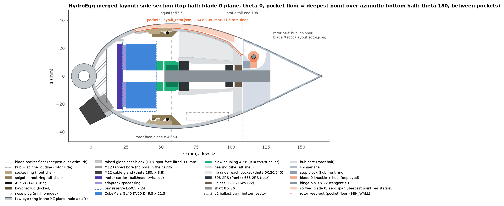
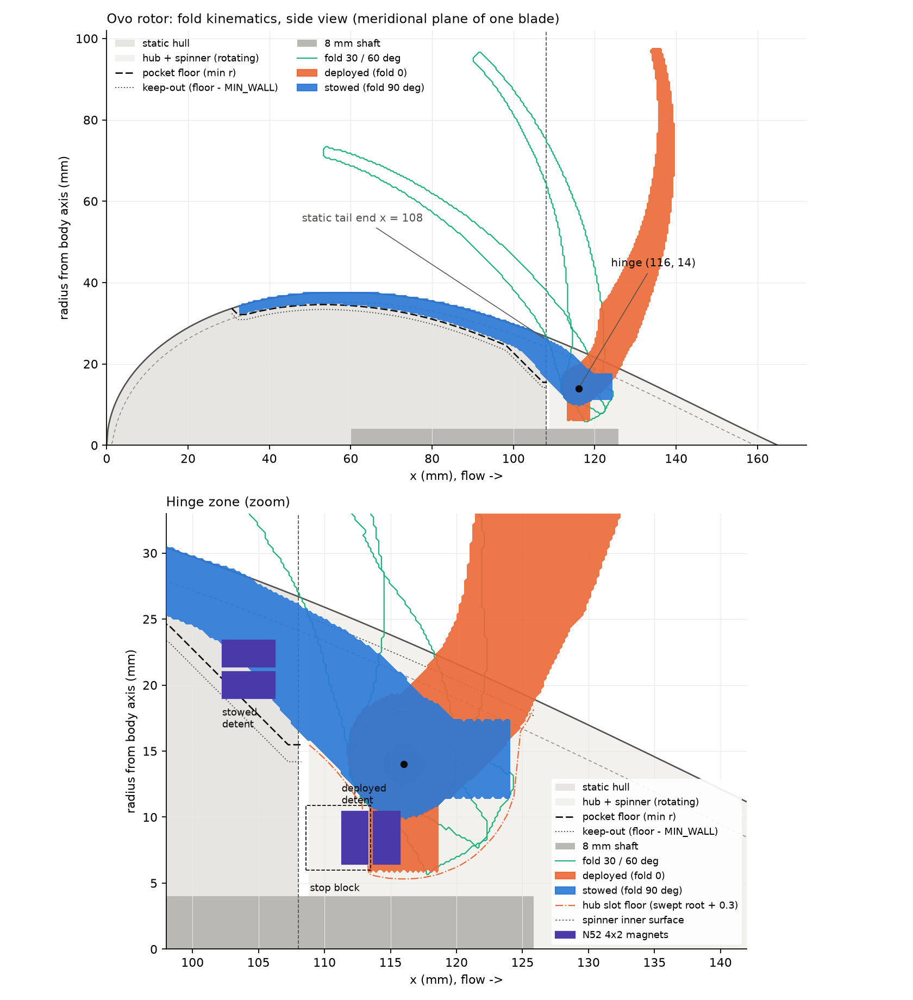
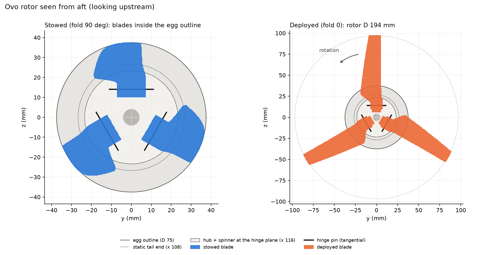
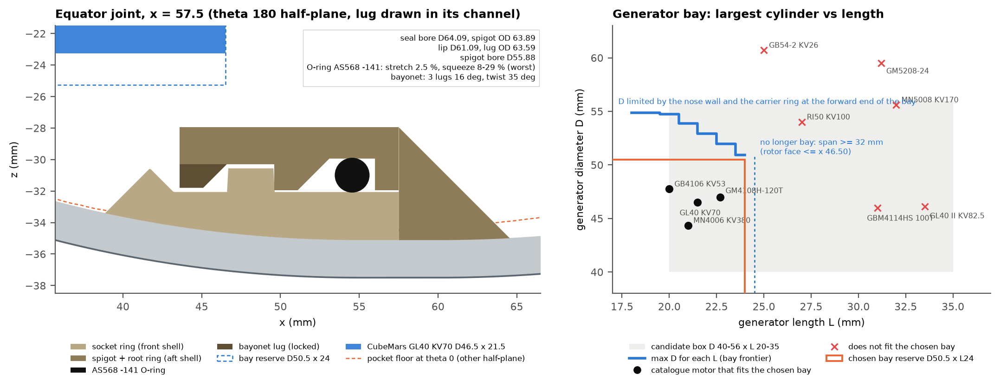
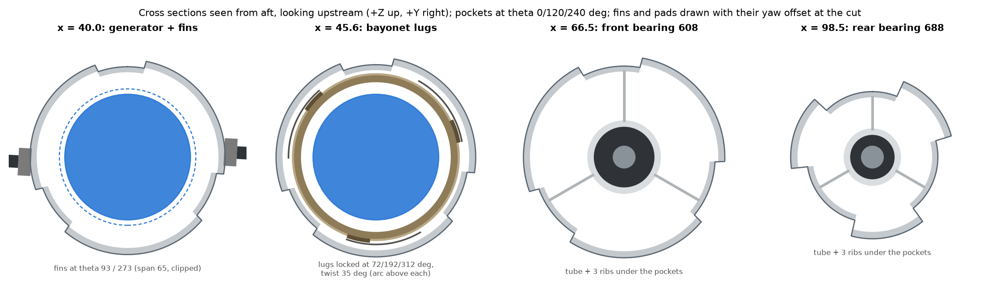
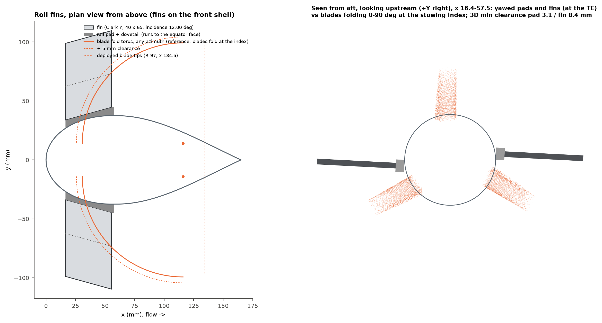

# Layout: rotor and internal, merged

Status: v1 layout after the review fix round, 2026-10-04. Sources: `hydroegg/layout.py` (rotor
half) and `hydroegg/layout_internal.py` (internal half and merge). Outputs: `data/layout.json`
(schema `hydroegg.layout/1`, the single consistent layout), plus the two half files it is built
from, `data/layout_rotor.json` and `data/layout_internal.json`. Every number below comes from
those files; values marked ESTIMATE are modelling assumptions, not sourced numbers.

Regenerate in this order:

```
python -m hydroegg.layout            # rotor half, about 75 s, writes data/layout_rotor.json
python -m hydroegg.layout_internal   # internal half + merge, about 25 s
```

`layout_internal` reads the rotor tables through `hydroegg.layout` (`layout.DATA_JSON`). If that
file is missing or its hinge, static tail or fold angle differ from `layout.CHOSEN`, it re-runs
`layout.run()` first, so the two halves cannot drift apart. It also reads the final blade and its
generator load line from `data/blade_design.json` and the equator O-ring, gland and motors from
`data/hardware.json`.

## Summary

| result | value |
|---|---|
| static tail end / hub front / shaft end | x 108 / 108.6 / 128 |
| hinge (tangential pin, 3 x 22) | x 116, r 14, fold 90 deg |
| blade pockets in the static hull | x 30.75 to 108; 3.02 mm deep at the equator, 6.82 max in the aero zone, 11.52 in the root notch; floors rise at most 45 deg |
| generator bay | D50.5 x L24 at x 22.5 to 46.5, the largest envelope that fits; CubeMars GL40 KV70 recommended |
| bearings | 608-2RS x 63 to 70 (locating), 688-2RS x 96 to 101 (floating), lip seal x 102.5 to 107.5 |
| bearing span / overhang to the thrust centroid | 32.0 mm / 37.8 mm (ratio 0.85); tip runout 0.30 mm, shaft deflection 0.015 mm, s0 28.5 / 22.1 |
| equator joint | ISO 3601 / AS568 -141 from the hardware study: seal bore D64.09, groove bottom D59.88, spigot OD 63.89, spigot bore D55.88; 3 lugs locked at theta 72 / 192 / 312, 35 deg twist |
| roll fins | Clark Y 40 x 65 at theta 93 / 273, x 16.37 to 55.5, incidence 12.0 deg, pads yawed about 0.15 c, 219 mm tip to tip; couple 1.110 x the GL40 load-line torque at 1.5 m/s |
| cable gland | M12x1.5 tapped in a raised D18 seat block at x 8.75 (bottom), axis 33.3 deg from the hull axis; no boss in the nose cavity |
| mass, display PLA / v2 PETG | 272.2 g (+1.08 N net) / 395.8 g (+0.051 N net, no ballast) |
| tow design load (3 x working) | 231 N |
| interface checks / cross-study checks | 29 of 29 / 2 of 2 pass |

The rotor half was taken as fixed and the internal half adapted to it (section 5). The review of
the merged layout raised 7 issues; section 6 lists what changed for each.

## 1. Frame and conventions

X is the body axis, flow travels +X, nose at x = 0, Z up, right handed. The two halves use
different azimuths:

* rotor half: `psi` about +X from +Z, `e_r = (0, -sin psi, cos psi)`; blade i sits at psi = 120 i.
  Pocket azimuths (`az_lo`, `az_hi`) are relative to the blade, + toward `e_t` (direction of
  rotation).
* internal half: `theta` about +X from +Z toward +Y, so `theta = -psi`. The blades sit at theta
  0 / 240 / 120 and a pocket spans `theta_blade + [-az_hi, -az_lo]`.

Pocket depth, floor and keep-out are radial. The depth at each x is the deepest point over
azimuth. The pockets are asymmetric: the stowed blade's lead and twist push them toward the
direction of rotation.

Both shells print with +X pointing down: the front shell stands on its equator face (nose up),
the aft shell on its tail end face. "Down" for the overhang rule (`MAX_OVERHANG` 45 deg from
vertical) is therefore +X on both. End views are drawn seen from aft, looking upstream, with +Z up
and +Y to the right.

## 2. Axial stations

| part | x from (mm) | x to (mm) | r (mm) | owner |
|---|---|---|---|---|
| tow eye (ring, hole centre at x -5.0) | -14 | 4 | - | internal |
| nose plug (infill, bridged) | 0 | 11.03 | - | internal |
| M12 gland seat block + tapped bore (theta 180, seat x 8.75) | 1.30 | 16.23 | - | internal |
| fin rail pads (yawed, to the equator face) | 15.33 | 57.5 | - | internal |
| fins (theta 93 / 273) | 16.37 | 55.5 | - | internal |
| motor carrier | 18.5 | 22.5 | 23.40 | internal |
| generator bay D50.5 x L24 | 22.5 | 46.5 | 25.25 | internal |
| CubeMars GL40 KV70 body | 25 | 46.5 | 23.25 | internal |
| blade pockets (static hull, 3x; 45 deg ramp at the forward end) | 30.75 | 108 | - | rotor |
| socket ring (front shell) | 41.70 | 57.5 | 32.05 | internal |
| bayonet spigot (aft shell) | 43.60 | 57.5 | 31.95 | internal |
| claw A (motor side) | 46.5 | 51.5 | 11 | internal |
| claw B + thrust collar | 52.5 | 63 | 11 | internal |
| shaft (8 mm) | 52.5 | 128 | 4 | internal |
| equator joint plane | 57.5 | 57.5 | - | internal |
| bearing tube (aft shell) | 62 | 108 | 13.4 | internal |
| 608-2RS (locating) | 63 | 70 | 11 | internal |
| 688-2RS (floating) | 96 | 101 | 8 | internal |
| seal shoulder | 101 | 102.5 | - | internal |
| tail end block (seal boss, notch floors) | 101 | 108 | - | internal |
| stowed-detent magnet seats (3x, notch floor) | 102.25 | 106.25 | 20.0 | rotor |
| lip seal TC 8x16x5 (v2) | 102.5 | 107.5 | 8 | internal |
| static tail end face | 108 | 108 | - | both |
| hub gap | 108 | 108.6 | - | both |
| stop block (hub front ring) | 108.6 | 113.5 | - | rotor |
| hub (rotating) | 108.6 | 128 | - | rotor |
| spinner shell | 108.6 | 165 | - | rotor |
| M3 grub on the shaft D-flat | 111.6 | 111.6 | - | rotor |
| hinge pins (tangential, r 14, axis at x 116) | 112 | 120 | 14 | rotor |
| heel, deployed | 113.5 | 118.5 | - | rotor |
| rotor thrust centroid (0.7 R, ESTIMATE) | 136.32 | 136.32 | - | both |

The gland row covers the seat block outside the hull and the tapped bore in the wall and the nose
plug; the bore opens into the cavity up to x 16.23 (the cable exit).



`layout_section.png`: top half in the blade 0 plane (theta 0) with the deepest pocket floor, the
stowed aero span of blade 0, the rotor keep-out line, the hub core with blade 0's clevis slot,
the pin, knuckle, heel and stop block; bottom half at theta 180, between pockets, with the gland
seat block, its bore and the gland.

## 3. Rotor half (hydroegg/layout.py)

Summary of `data/layout_rotor.json` (re-run in this round; the file is byte-identical to the one
the internal half was built on). The full tables (blade axis, pocket table, hub slot, detents) are
copied into `layout.json` under `rotor`.

* **Hinge.** A hinge sweep over x 116 to 118, r 13.5 to 14.5 and a static tail 6, 8 or 10 mm ahead
  of the hinge (11 points) picked x 116, r 14, static tail x 108: the largest smallest margin
  (pin cover 2.46 mm in the hub core, stowed heel 1.35 mm inside the spinner, 4.88 mm heel face for
  a 4 mm magnet). A static tail at x 110 fails the 0.8 mm root clearance (0.77).
* **Blade root.** An 8 x 14 mm knuckle between two 3.7 mm hub ears on a 3 x 22 tangential pin. A
  5 x 8 x 10 mm heel bears on the hub front ring (stop face x 113.5) as the deployed stop. The
  shank leaves the knuckle at a 55 deg cone.
* **Pre-cone and stowage.** The aft offset is solved per station so the stowed section top is
  flush with the hull (max +0.065 mm). An in-plane lead (11.5 mm at the root to 4.8 mm at the tip)
  cuts the deepest station pocket from 12.6 mm (radial stacking) to 4.9 mm. The deployed cone is
  12.6 deg mean hinge to tip, +25.0 deg local at the root, -16.0 deg at the tip.
* **Pockets.** x 30.75 to 108, at most 6.82 mm deep in the aero zone (x <= 100) and 11.52 mm in the
  root notch, widest 36.5 mm, land between pockets at least 26.6 mm. `printable_floor` cuts the
  floor so it rises at most 45 deg going forward (both shells print +X down): the root-notch ramp
  and the pocket's forward end at x 30.75 are 45 deg ramps. The rotor keep-out (floor minus
  MIN_WALL along the hull normal) is at least 14.19 mm in the last 12 mm of the static tail.
* **Hub.** D-flat bore with an M3 grub at x 111.6, pins pressed into the ears, the 1.2 mm spinner
  retains them, one M3 screw into the tapped shaft end carries the thrust. Hub wall over the bore
  is 1.24 mm (MIN_WALL 1.2) in the heel slots.
* **Detents.** 12 magnets (4 x 2 N52): 2.32 N per pair at 0.4 mm (model, calibration k 0.63),
  12.9 N mm holding deployed and 25.8 N mm holding stowed, 6.3x and 12.6x the worst gravity moment
  of the 8.0 g blade (ESTIMATE, solid PLA).
* **Loads at 2.5 m/s (ESTIMATES).** The hub load cases use the BEM `layout_axis_check` on the
  solved curved axis: flap moment 1.343 N m (1.269 on the nominal axis), stop force 237 N, stop
  contact 4.86 MPa, pin double shear 18.4 MPa, ear bearing 11.7 MPa.




## 4. Internal half (hydroegg/layout_internal.py)

* **Generator bay.** The motor sits in the front shell on a twist-lock carrier with its rotor face
  aft. The carrier needs r >= 23.37 mm for the PCD 38.14 adapter of the alternative motor, which
  puts the bay front at x >= 22.5; the bearing span (>= 32 mm) keeps the rotor face at x <= 46.5,
  so no bay is longer than 24 mm. The bay is the largest envelope that fits, D50.5 x L24 at x 22.5
  to 46.5 (frontier D 50.94 at L 24, set by the nose wall and the carrier ring at the bay's forward
  end). Fits are tested against this bay: GM4108H-120T (D47 x 22.7), GL40 KV70 (D46.5 x 21.5),
  GB4106 KV53 (D47.75 x 20) and MN4006 KV380 (D44.35 x 21) fit; the L 27 to 33.5 motors
  (GBM4114HS, GL40 II, RI50, MN5008) and the D59.5 / D60.7 motors do not. The bay clears the
  shell's inner wall and the pocket floors by 2.32 mm; the GL40's rotor face (x 46.5) lies aft of
  the spigot tip (x 43.60), 2.69 mm radially clear of the spigot bore.
* **Drivetrain.** Claw coupling (claw A on the motor at x 46.5 to 51.5, 1 mm float, claw B over a
  Ruland MSC-8-SS collar at x 52.5 to 63, the thrust collar on the 608 inner race). Claw B is OD 22
  to x 60.5, then steps to OD 20 for its last 2 mm, ahead of a 0.5 mm OD 12 shim, so where it runs
  inside the static tube mouth (x 62 to 63, 608 seat bore 21.9 printed) it has 0.95 mm radial
  clearance; the mouth has a 0.5 x 45 deg lead-in. 608 locating at x 63 to 70, 688 floating at
  x 96 to 101, seal shoulder, TC 8x16x5 lip seal at x 102.5 to 107.5, 0.5 mm inside the static tail
  face. The tube is 13.4 / 10.4 mm in outer radius on 3 ribs under the pocket floors. The shaft is
  8 x 75.5 mm (x 52.5 to 128): a flat for claw B, the hub D-flat, a retaining-ring groove and an
  M3 x 8 tapped aft end.
* **Equator joint.** The joint adopts the hardware study's ring and groove as they are: ISO 3601 /
  AS568 -141 (ID 58.42), groove bottom D59.88 (stretch 2.5 %, 1.44 to 3.57 % over the tolerances),
  bottom width 2.9 mm with the 45 deg tip-side flank (top 4.905 mm, 2.005 mm deep in the spigot),
  seal bore D64.09, spigot OD 63.89 (0.1 mm radial clearance). Recomputed here with the same
  worst-case model: squeeze 18.7 % nominal and 7.7 to 29.0 % worst, fill 63.4 % nominal and 79.7 %
  worst, equal to `hardware.json` (cross-study check, 0.0 mm deviation). The pockets are 3.02 mm
  deep at x 57.5; the socket keeps 2.44 mm of wall under the pocket floor (bore limit D64.97). Lip
  D61.09, lug OD 63.59, spigot bore D55.88. The three 16 deg lugs lock at theta 72 / 192 / 312
  after a 35 deg twist; their channel stays 10.63 mm clear of the pocket edges, and lug shear is
  0.17 of the PETG interlayer strength under the 231 N tow design load.
* **Nose.** Printed tow eye (8 mm hole, 5 x 6 ring in the XZ plane; legs at 0.21, crown at 0.41 of
  the PETG strengths). Forward of x 11.03 the nose is an infilled plug with a 38.6 mm bridge as its
  back face. The M12 gland sits beside the eye at the bottom (theta 180): hull point x 8.75, spot
  face lifted 3.0 mm along an axis 33.3 deg from the hull axis (10 deg from the surface normal
  toward the nose), on a raised D18 seat block. The thread is tapped through the block, the wall
  and the plug, and keeps at least 6.05 mm of the 8 mm gland thread in solid material on every
  generatrix (mean 7.12). Nothing of the gland stands in the open cavity; the bore (cable exit) ends
  2.28 mm ahead of the carrier plate and 1.08 mm ahead of its ring, and the gland body is 7.07 mm
  from the eye and 10.0 mm from the shackle envelope. The block's side and the bore lean 33.3 deg
  from vertical (printable nose-up). The cost is a chin: the seat rim stands 6.79 mm proud of the
  hull. The cable runs through a 7.5 x 7.5 mm notch in the carrier rim at theta 180 (bottom r 15.90,
  5.50 mm from the nearest screw counterbore; the motor pattern is clocked 45 deg).
* **Fins.** Two Clark Y fins, 40 x 65 mm (26.0 cm2 each, AR 1.625) at theta 93 / 273, x 16.37 to
  55.5, incidence 12.0 deg. Each fin and its rail pad are yawed by the incidence about the radial
  line through the pivot at 0.15 c (x 22.24), trailing edge toward -theta; the pad runs to the
  equator face (x 57.5). Sizing (section 6, item 9): the couple at 1.5 m/s is 0.1958 N m, 1.110 x
  the GL40 load-line torque of 0.1764 N m. Off design the ratio is 0.894 at 1.0 m/s and 1.180 at
  2.5 m/s; CL is at most 0.60 against CLmax_3D 1.08 to 1.20. Clearances: yawed pad to pocket edge
  2.22 mm, blades folding at the stowing index to pad 3.09 mm and to fin 8.44 mm (limits 2.0). Tow
  drag 1.74 N for the pair, root stress 1.35 MPa (0.029 of the PETG XY strength).
* **Roll.** Nothing restores roll angle (pendulum 0.0002 N m against Q 0.1764 N m), so any
  mismatch rolls the hull: +11.0 % at 1.5 m/s is 5.0 rpm against the rotor, -10.6 % at 1.0 m/s is
  3.7 rpm with it, +18.0 % at 2.5 m/s is 13.4 rpm. A two-leg bridle on two nose eyes would hold it
  at 8.4 deg heel at 1.5 m/s. With no electrical load the fins roll the hull at 50 rpm.
* **Mass (ESTIMATES for print fill and hardware).** The display PLA model is 272.2 g and floats
  with +1.08 N. The v2 (PETG, real GL40) is 395.8 g with +0.051 N net and its CG 3.8 mm ahead of the
  CB. Displacement counts the sealed static hull minus the wet pockets, the fin pads outside the
  hull minus their grooves, the gland seat block, and the rotor parts minus what floods (3 blade
  slots 11.7 cc, the spinner's screw-access bore 0.9 cc, the spinner gap 0.5 cc). The +0.3 N target
  needs 25.4 g less mass (4-perimeter shells save 22.5 g) or about 26.2 cc of float.
* **Print split.** Both shells print without supports and every part fits the 256 mm bed (front
  shell bbox 93.2 x 75 x 71.5 mm with the fin pads, aft shell 75 x 75 x 64.4 mm).





## 5. Merge decisions

**Who moved.** No rotor value changed. Every conflict was resolved on the internal side.

**Static tail 118 to 108 and the bearing span.** The bearings and seal follow the static tail end,
so they moved 10 mm forward. The internal half takes the rotor load plane from the solved curved
blade axis: the thrust centroid (0.7 R, ESTIMATE) sits at x 136.3, so the overhang from the 688
centre is 37.8 mm. With the GL40 alone at its forward-most position the span is 34.5 mm (ratio
0.91). No bay that holds the recommended motor meets the 1.25 span/overhang rule of thumb. The
loads are small (s0 above 20), so the rule was replaced by explicit checks:

| criterion | limit | value |
|---|---|---|
| span | >= 4 d = 32 mm | 32.0 mm |
| blade-tip axial runout from 0.05 mm seat slop | <= 0.5 mm | 0.30 mm |
| static safety C0 / P0 (tow case) | >= 4 | 28.5 (608), 22.1 (688) |
| shaft deflection at the load plane (radial load + asymmetry moment) | <= 0.05 mm | 0.015 mm |
| span / overhang (reported only) | 1.25 rule of thumb | 0.85 |

**Generator bay length.** The span criterion caps the rotor face at x 46.5. The hardware study's
L33 reserve covered the GM4108H encoder variant; at its forward-most position it would cut the
span to 23.0 mm (tip runout 0.42 mm), so it was dropped.

| bay L (mm) | rotor face x | span (mm) | span / overhang | tip runout (mm) | passes |
|---|---|---|---|---|---|
| 21.5 | 44.0 | 34.5 | 0.91 | 0.28 | yes |
| 24 (chosen) | 46.5 | 32.0 | 0.85 | 0.30 | yes |
| 28 | 50.5 | 28.0 | 0.74 | 0.35 | no (span) |
| 33 | 55.5 | 23.0 | 0.61 | 0.42 | no (span) |

**Equator position.** Moving the equator over x 52.5 to 60 changes neither the joint nor the bay
(D 50.94 at L 24 at every position), so x 57.5 stays: it keeps the seal in the parallel band. The
bay would shrink below D50.94 only if the pockets were deeper than 5.47 mm at the equator.

**Pockets at the joint.** The real pockets are shallower at the equator than the fallback (3.02 mm
instead of 6), but they extend forward to x 30.75 and are asymmetric. The joint keeps 2.44 mm of
socket wall under the floor, so the local shell thickening the rotor study asked for is the socket
and spigot rings themselves. The lugs sit in the land centres (lock theta 72 / 192 / 312).

**Hub, bearing and seal axial stack.** There is no overlap. The seal ends at x 107.5 (0.5 mm inside
the static tail face) and the hub starts at x 108.6, after the 0.6 mm hub gap. The shaft end equals
the hub aft face (x 128) for the spinner screw, and the grub's D-flat (x 111.6) lies inside the
hub. The tail end block (x 101 to 108) is solid from the seal bore out to the notch floors. It
carries the three stowed-detent magnet seats (centre r 20.0; 9.8 mm of material between their
keep-out and the seal bore).

**Keep-out definitions.** The rotor keep-out is the floor minus MIN_WALL (1.2 mm). The internal half
keeps 2.0 mm (`POCKET_FLOOR_WALL`) under every floor, so it is 0.8 mm stricter. The bearing tube
clears the floor shell by 2.93 mm and the rotor keep-out by 3.79 mm, both at the tail notch.

**Fins: fold rule.** With the hinge at (116, 14), the any-azimuth fold torus limits the TE of a
40 mm chord fin to x 31.08. That rule gives 25 x 85 fins at x 4.96 to 29.69, 251 mm tip to tip.
The blades must sit over their pockets before they fold, so the fins only clear the sweep at the
stowing index. This is checked on the rotor half's swept blade surface, fold 0 to 90 deg in 1 deg
steps, all three blades. The fins can then use the whole front shell (TE at x 55.5, 2 mm ahead of
the joint).

## 6. Review fix round

The adversarial review of the merged layout (verdict: needs fixes) raised 2 major and 5 minor
issues. Two further items came from the other studies.

1. **Fin rail pads with their yaw (major).** The pad is now modelled as the yawed rectangle, with
   its pivot as a design variable, in the fin selection, the pad-to-pocket check and the 3D
   fold-clearance check. Its side walls are planes parallel to the radial line at the fin angle, so
   a footprint point at lateral offset `lat` meets the hull at `theta + asin(lat / R)`; with
   `lat / R` the check would overstate the margin by about 0.3 mm at the far end of a yawed pad.
   The search re-picked theta 93 / 273 and the pivot 0.15 c: pad to pocket 2.22 mm, folding blades
   to pad 3.09 mm and to fin 8.44 mm (limits 2.0). The review had shown the old fin at theta
   84.5 / 264.5 overlapping a pocket once its pad was yawed.
2. **Gland check on the whole gland and boss (major).** The merge's boss at x 12 on the surface
   normal reached x 23.28, through the carrier plate into the bay. The check now covers the seat
   block, the bore up to the cable exit and the gland body against the carrier plate, its ring
   (and so its 30 deg twist, which happens in place at x >= 18.5), the bay, the eye and the
   shackle. A first fix (seat x 6, tilt 17.5) cleared the carrier, but its D16 thread boss hung in
   the nose cavity behind the plug bridge, a 70.7 deg overhang for a front shell that prints
   nose-up. Without that boss its thread kept only 4.25 mm. The final seat (section 4, Nose) has no
   boss in the cavity: the placement search over seat x, axis tilt and seat lift takes the lowest
   seat rim with at least 75 % of the thread in solid material, every printed surface within
   45 deg and all clearances met.
3. **v2 buoyancy (minor).** The hub and spinner no longer count as a sealed solid: the three blade
   slots (11.7 cc), the spinner's screw-access bore (D6, 0.9 cc) and the spinner gap (0.5 cc)
   flood. The spinner aft of the hub face is printed closed around that bore. The fin pads (outside
   the hull, minus their grooves) and the gland seat block count. v2 net buoyancy is +0.051 N; the
   +0.3 N target needs 25.4 g less mass or 26.2 cc of float (4-perimeter shells save 22.5 g, then
   about 3.0 cc of foam).
4. **Claw B in the tube mouth (minor).** Claw B steps from OD 22 to OD 20 over its last 2 mm and the
   tube mouth gets a 0.5 mm lead-in: 0.95 mm radial running clearance (limit 0.3).
5. **Support-free shells (minor).** The fin pads run down to the equator face, so their aft ends
   stand on the bed (a 45 deg chamfer from the rail stop would need 7.1 mm, past the equator). The
   rotor half's `printable_floor` cuts the pocket floors to rise at most 45 deg (root-notch ramp and
   forward end). The gland seat (item 2) prints at 33.3 deg.
6. **Figure labels (minor).** `layout_section_cross.png` and the right panel of
   `layout_section_fins.png` now say "seen from aft, looking upstream (+Y right)". They plot
   (rho sin theta, rho cos theta), and a viewer looking upstream (along -X) with +Z up has +Y on
   the right.
7. **Bay claims (minor).** The bay is the largest envelope that fits, D50.5 x L24, and candidate
   fits are tested against it, not against the shell frontier. The GB4106 (D47.75 x L20) does fit
   this bay (1.375 mm radial room). The bay length is capped at 24 mm by the bearing span
   (section 5), which is why the hardware study's L33 reserve is not kept.
8. **Equator O-ring from the hardware study.** `oring_pick` adopts `hardware.json`
   `oring_equator` (ring, groove form, diameters, clearance) and only checks that the bore fits the
   wall limit, then recomputes the gland with the hardware study's worst-case model, including the
   corrected direction of the ID tolerance (thinnest section = smallest cs and smallest free ID).
   Layout and hardware study agree to 0.0 mm (cross-study check).
9. **Fins sized on the GL40 load line.** The fin couple must be 1.10 to 1.155 x the recommended
   generator's load-line torque at the design flow, 0.1764 N m at 1.5 m/s and TSR 5.75
   (`blade_design.json`, `generator_coupling_estimate.load_line_by_flow`, capped point), with CL at
   most 0.75 CLmax_3D at 1.0, 1.5 and 2.5 m/s. The 10 % margin covers lift that a printed Clark Y
   at Re about 55 k may not reach (the polars are smooth-surface) and the estimated GL40 drag torque
   (0.0248 N m). The merge's rule (Cp 0.35 at TSR 4) gave 0.282 N m, 1.60 x the load-line torque.
   Result: 1.110. Trim fins with the root tongue turned +-1 deg about the yaw pivot change the
   couple by 7.5 % per degree and move the fin box by at most 0.59 mm. The blades still fold only
   at the stowing index.

## 7. Interface checks

| check | value (mm) | limit (mm) | pass |
|---|---|---|---|
| static tail end: rotor half = internal half | 108 | 108 | yes |
| hinge (x, r): rotor half = internal half | 116 / 14 | 116 / 14 | yes |
| shaft aft end = hub aft face (spinner M3 screw thread) | 128 | 128 | yes |
| hub gap = HUB_GAP | 0.6 | 0.6 | yes |
| lip seal outer face ahead of the hub front (axial gap) | 1.1 | 0.6 | yes |
| no axial overlap: 688 / shoulder / seal inside the static tail | 107.5 | 108 | yes |
| M3 grub (shaft D-flat) inside the hub on the shaft | 111.6 | 108.6 / 128 | yes |
| bearing tube to pocket floor (internal 2.0 mm floor wall) | 2.93 | 0 | yes |
| bearing tube to rotor keep-out (floor - MIN_WALL) | 3.79 | 0 | yes |
| 688 tube radius under the tail notch keep-out | 10.4 | 14.19 | yes |
| stowed-detent magnet keep-out to the seal bore (end block material) | 9.80 | 2 | yes |
| socket wall under the pocket floor at the joint | 2.44 | 2 | yes |
| bayonet twist channel to pocket edges (arc) | 10.63 | 2 | yes |
| generator bay to the shell inner wall and pocket floors (radial) | 2.32 | 0.5 | yes |
| yawed fin rail pads to pocket edges (arc) | 2.22 | 2 | yes |
| yawed fins and pads to blades folding at the stowing index (3D) | 3.09 | 2 | yes |
| fin pad aft end printable (runs to the equator face) | 57.5 | 57.5 | yes |
| pocket floor overhang (printed +X down, rotor half) | 45.0 deg | 45 deg | yes |
| claw B (rotating) to the static tube mouth, radial | 0.95 | 0.3 | yes |
| bearing span rule (span >= 4 d, tip runout, s0, shaft deflection) | 32 | 32 | yes |
| hub wall over the shaft bore at the heel slots (rotor) | 1.24 | 1.2 | yes |
| rotor interference (folding, neighbours, heel, deployed span) | - | - | yes |
| gland seat block and bore (cable exit) ahead of the carrier plate | 2.28 | 1 | yes |
| gland seat block and bore ahead of the carrier ring on the shell | 1.08 | 1 | yes |
| gland thread engagement in solid material (min over the M12 generatrices) | 6.05 | 6.0 | yes |
| gland seat block and bore printable nose-up | 33.3 deg | 45 deg | yes |
| gland body to the tow eye and the shackle envelope | 7.07 | 2 | yes |
| carrier cable notch clear of the motor screw counterbores and the centre bore | 5.50 | 2 | yes |
| joint lug shear utilisation (interlayer proxy, ratio) | 0.17 | 0.5 | yes |

**Cross-study checks (both pass).** Fin couple at 1.5 m/s against the GL40 load-line torque:
1.110 (limits 1.10 to 1.155). Equator O-ring and groove, layout against hardware study: 0.0 mm
deviation.

An independent re-check of the fin pads (scratch script, raw `layout_rotor.json` pocket edges,
planar pad walls, 0.1 mm sampling) gave 2.20 mm pad to pocket and 3.10 / 8.44 mm to the folding
blades, so the sampled module values hold to about 0.02 mm.

## 8. Proposed params.py updates (consolidated)

`data/layout.json` `proposed_param_updates` holds the full set with every value the CAD needs and a
`*_reason` for each. The table lists the values; the JSON also carries the table references
(pocket, blade axis, hub slot) and the reasons.

| param | value |
|---|---|
| `STATIC_TAIL_X` | 108 |
| `HINGE_X` / `HINGE_R` | 116 / 14 |
| `ROTOR_R_TIP_TARGET` | 97 (unchanged) |
| `PIN_L` | 22 (ISO 8734 3 x 22, VERIFY stock) |
| new `FOLD_DEG`, `KNUCKLE_D`, `KNUCKLE_L`, `HUB_EAR_T`, `SHANK_CONE_DEG` | 90, 8, 14, 3.7, 55 |
| new `HEEL_REACH`, `HEEL_T`, `HEEL_W` | 8, 5, 10 |
| new `SHAFT_AFT_X`, `POCKET_CLEAR`, `ROOT_CLEAR`, `POCKET_FLOOR_WALL` | 128, 0.3, 0.8, 2.0 |
| new `ROTOR_HUB` | x 108.6 to 128, bore 8.15 with 0.5 D-flat, M3 x 4 grub at x 111.6 (psi 60), stop face x 113.5, ear hole 3.0, knuckle bore 3.3, spinner wall 1.2, gap 0.2 |
| new `DETENTS` | 4 x 2 N52; hub magnet at (x 112.3, r_e 8.44), stowed seat x 104.25, az 18.75, r 20.0, boss top r 21.2 |
| new `POCKETS`, `BLADE_AXIS` | x 30.75 to 108, theta 0 / 120 / 240, floors <= 45 deg (tables in `layout_rotor.json`); lead 11.5 to 4.8 |
| `EQUATOR_X` | 57.5 (kept) |
| `BEARING` (608-2RS) / `BEARING_ALT` (688-2RS) | x0 63 (locating) / x0 96 (floating) |
| `LIP_SEAL` | TC 8x16x5, x0 102.5, recess 0.5 |
| new `BEARING_TUBE` | x 62 to 108, r_out 13.4 / 10.4 (profile x 62, 72, 94, 96, 108), seats D22 / D16, shoulder ID 18 (x 70 to 96), seal shoulder ID 12.5 (x 101 to 102.5), seal bore 16, lead-in 0.5, 3 ribs t 2 at theta 0 / 120 / 240 |
| new `TAIL_END_BLOCK` | x 101 to 108, solid |
| `GENERATOR` | CubeMars GL40 KV70 D46.5 x 21.5, PCD 24 (4 x M3); bay D50.5 x L24 at x 22.5 to 46.5, body x 25 to 46.5, spacer 2.5; alternative GM4108H-120T (PCD 38.14) |
| new `CARRIER` | x0 18.5, t 4, r 23.40, twist 30, centre bore 16, screws clocked 45 deg, ring x 17.3 to 23.7 (t 1.6), cable notch 7.5 x 7.5 at theta 180 |
| new `COUPLER` | OD 22, claw A 5 (x 46.5 to 51.5), float 1, claw B 10.5 (x 52.5 to 63) with OD 20 step over its last 2, shim OD 12 x 0.5, Ruland MSC-8-SS |
| new `SHAFT` | d 8, x 52.5 to 128 (L 75.5), hub flat x 111.6 depth 0.5, M3 x 8 aft tap |
| new `JOINT` | spigot tip x 43.60, lip x 46.60 to 49.60, seal zone x 49.60 to 57.5, channel x 43.20 to 46.60, groove x 51.10 / 53.1 / 56.0; seal bore D64.09, spigot OD 63.89, groove D59.88, lug OD 63.59, lip D61.09, spigot bore D55.88 |
| `ORING_EQUATOR` | ISO 3601 / AS568 -141 (ID 58.42, cs 2.62), groove bottom D59.88 x 2.9 wide, top 4.905, depth 2.005 in the spigot, gland depth 2.105, aft flank radial, tip-side flank 45 deg, bore D64.09, spigot OD 63.89 |
| new `BAYONET` | 3 lugs 16 deg, h 1.5, t 3, gap 20 deg, twist 35, lock theta 72 / 192 / 312, entry 37 / 157 / 277, lip t 3 |
| new `FIN` | Clark Y, chord 40, span 65, incidence 12.0, x 16.37 to 55.5, theta 93 / 273, yaw pivot 0.15 c (x 22.24), TE toward -theta, root r 33.79 to 44.60, pad w 10 (h >= 4) x 15.33 to 57.5, half-dovetail groove 6 x 4, trim variants +-1 deg |
| new `GLAND` | M12x1.5, theta 180, hull point x 8.75, tilt 10 deg (axis 146.65 deg from +X), seat lift 3.0, spot face centre (x 6.24, r 21.94), seat D18, thread 8 (inner end x 12.93, r 17.55); no boss in the cavity |
| new `TOW_EYE`, `NOSE_PLUG` | eye hole 8, ring 5 x 6, plane XZ, hole centre x -5; plug to x 11.03, bridge D38.6 |
| new `SPINNER_ACCESS`, `BALLAST_V2` | D6 bore x 134 to 165, aft wall 3; ballast 0 g (v2 needs float, not lead) |

## 9. Open issues

1. **Bearing span.** 32.0 mm against a 37.8 mm overhang (ratio 0.85). The explicit checks pass,
   but measure rotor wobble on the prototype. Only a longer static tail would restore the ratio,
   and the rotor sweep rejects x 110.
2. **Bay length.** The L33 reserve (GM4108H encoder variant, GL40 II, GBM4114HS) does not fit.
3. **Roll angle.** The fins carry the mean torque only; v2 needs a two-leg bridle (8.4 deg heel at
   1.5 m/s) or a cable swivel, a load on the generator at all times, and trim fins set after the
   first wet test.
4. **Fold procedure.** The fins span 219 mm (rotor 194 mm) and come off for transport. With the
   fins on, fold the blades only at the stowing index. The pad footprint, the pocket raster and
   the fold sweep are sampled: confirm the 2.22 / 3.09 mm margins on the CAD.
5. **v2 buoyancy.** +0.051 N without ballast; reaching +0.3 N needs 25.4 g less or about 26 cc of
   external float.
6. **Gland seat.** The raised seat block's rim stands 6.79 mm proud of the nose; the thread keeps
   6.05 of 8 mm in printed material. Tap after printing and check the gland's tightening on a test
   print.
7. **O-ring squeeze.** Worst-case squeeze is 7.7 %, under the 14 % table minimum (acceptable below
   0.1 bar). Verify with a printed test ring.
8. **BEM inputs.** `blade_design.json`'s rotor block still lists hinge (124, 18.5) until params.py
   adopts the proposed values; its `layout_axis_check` flew the final blade on (116, 14) and the
   solved axis (cp peak 0.3802 against 0.3804). The in-plane lead yaws sections by up to 21 deg,
   which BEM ignores. The load plane x 136.3 is the solved axis at 0.7 R (ESTIMATE).
9. **Magnet detents.** Magnet forces are modelled. Check the detent feel on a test print; the
   stowed hold (25.8 N mm) may keep the flow from opening the blades.
10. **Assembly flags.** The shaft flat must pass the lip seal (needs a sleeve), and the claws engage
    blind.
11. **Pin stock and hub wall.** Pin 3 x 22: check stock (fallback 3 x 20 with 2.7 mm ears). The hub
    wall over the bore is 1.24 mm, at MIN_WALL, in the heel slots.
12. **Unsourced values.** Rotor loads, the joint shear proxy, hull C_D 0.10, the radial load
    fraction and the 0.7 R thrust centroid are ESTIMATES. Printed PETG shear allowables were not
    sourced.
